# CredSort — Diagrams as Code

**Status:** Proposed diagram pack for Architecture Baseline & Master Product Plan v1.0  
**Format:** Mermaid in Markdown (`.md`) plus standalone `.mmd` source files  
**Language:** English (aligned with the existing plans)  
**Scope:** Swiss SME credit marketplace MVP. Real bank lending and empirically validated credit ratings are **not** implemented in the demo.

> These are **design diagrams**, not reverse-engineered diagrams of a deployed application. They describe agreed target behavior and assumptions to verify during development. They are based on `CredSort_Architecture_Implementation_Plan_EN_v1.md` and `CredSort_Master_Product_Development_Plan_EN_v1.md`.

## Diagram index

| No. | Diagram | Purpose |
|---|---|---|
| 01 | [System Context](#01-system-context) | Who interacts with CredSort and which external systems it uses. |
| 02 | [Containers and Deployment](#02-containers-and-deployment) | One logical backend, one relational database, and two outside API providers. |
| 03 | [Backend Modules and Public Interfaces](#03-backend-modules-and-public-interfaces) | Module dependency direction: consumers call owner api.py; owned database schemas are not accessed by other modules. |
| 04 | [Financial Data Lineage and Separation of Scores](#04-financial-data-lineage-and-separation-of-scores) | Canonical accounting flow, immutable data provenance, and distinct assessment/matching outputs. |
| 05 | [Sequence — bexio Connection, Import and Assessment](#05-sequence--bexio-connection-import-and-assessment) | End-to-end asynchronous import, 202 + polling, reproducible snapshot, and the manual retry path. |
| 06 | [Sequence — Consent, Lender Matching and Offer Selection](#06-sequence--consent-lender-matching-and-offer-selection) | Privacy-safe discovery and transactional selection of an immutable loan offer. |
| 07 | [Sequence — AI Advice and Deterministic What-if](#07-sequence--ai-advice-and-deterministic-what-if) | Calculations remain deterministic, while the LLM only explains permitted aggregate results. |
| 08 | [Entity Relationships — Accounting and Analysis](#08-entity-relationships--accounting-and-analysis) | Conceptual model of the versioned data pipeline; primary and foreign key names are illustrative. |
| 09 | [Entity Relationships — Access and Lending](#09-entity-relationships--access-and-lending) | Conceptual model for organizations, publication permissions, applications, immutable offers and audit records. |
| 10 | [State Machine — Accounting Import Job](#10-state-machine--accounting-import-job) | Manual retry creates a new job; unfinished jobs are failed on single-process startup. |
| 11 | [State Machine — Loan Application](#11-state-machine--loan-application) | Offers-received is a derived UI state, not a stored application status. |
| 12 | [State Machine — Loan Offer](#12-state-machine--loan-offer) | Immutable offer terms; only an authorized SME can select; at most one SELECTED per application. |
| 13 | [Privacy Decision Flow — Matching Eligibility](#13-privacy-decision-flow--matching-eligibility) | Prevents indirect disclosure through filters, ranking, results, and counts. |
| 14 | [Master Product Roadmap and Dependencies](#14-master-product-roadmap-and-dependencies) | Product milestones; validation can run in parallel with implementation. |

## Design conventions and constraints

- **Financial Assessment ≠ Data Confidence ≠ Lender Match ranking.** Scoring is demonstrative, not a validated probability of default.
- **Connecting bexio ≠ consent to disclose.** Discovery requires published applications and per-field matching permissions.
- **One Modular Monolith:** five modules (`access`, `accounting`, `analysis`, `lending`, `advisory`), one FastAPI process and one PostgreSQL instance for the initial architecture; no message broker.
- **Portals:** Next.js SME Portal and Lender Portal; bexio is an external accounting system, not the bank platform.
- **Data lineage:** immutable, versioned imports/snapshots/assessments. Loan offers retain immutable terms after submission.
- **Assumptions:** OAuth callback shape, bexio data availability, rate benchmark inputs, and any real bank integration need empirical verification.
- **Sequence semantics:** the arrows represent logical calls. Real implementation must define precise FastAPI routes, transaction scopes and errors.

## 01. System Context

Who interacts with CredSort and which external systems it uses.

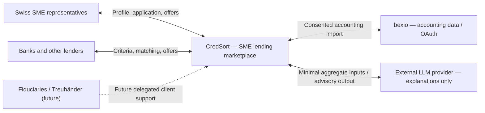

## 02. Containers and Deployment

One logical backend, one relational database, and two outside API providers.

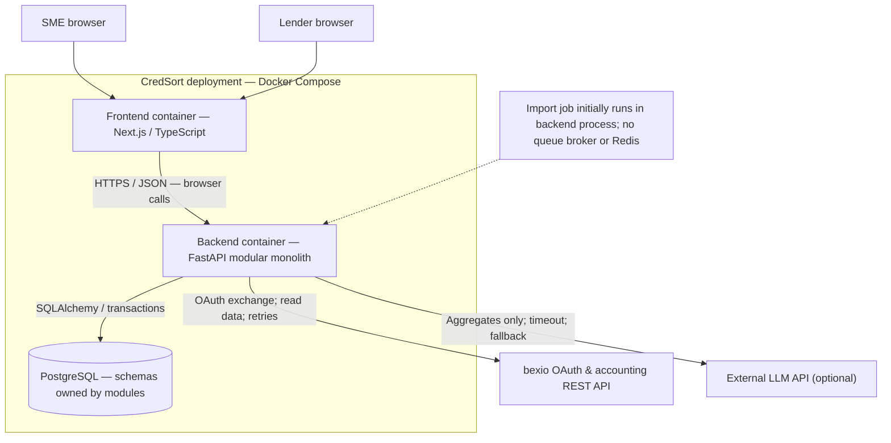

## 03. Backend Modules and Public Interfaces

Module dependency direction: consumers call owner api.py; owned database schemas are not accessed by other modules.

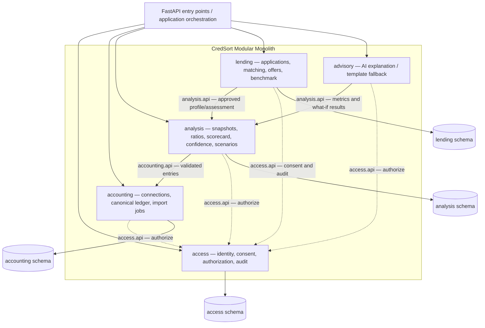

## 04. Financial Data Lineage and Separation of Scores

Canonical accounting flow, immutable data provenance, and distinct assessment/matching outputs.

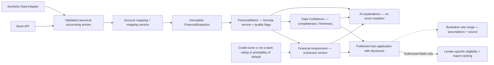

## 05. Sequence — bexio Connection, Import and Assessment

End-to-end asynchronous import, 202 + polling, reproducible snapshot, and the manual retry path.

```mermaid
sequenceDiagram
  autonumber
  actor SME
  participant UI as SME Portal
  participant API as FastAPI / access
  participant ACC as accounting ImportService
  participant BX as bexio OAuth / API
  participant DB as PostgreSQL
  participant ANA as analysis

  SME->>UI: Connect bexio account
  UI->>API: Request bexio authorization
  API-->>UI: Redirect to bexio authorization endpoint
  UI->>BX: User authorization (browser redirect)
  BX-->>API: Authorization callback / code
  API->>BX: Exchange code for credentials
  BX-->>API: Scoped access / refresh tokens
  API->>DB: Store encrypted connection credentials
  API-->>UI: Connection active

  SME->>UI: Import accounting data
  UI->>API: POST /companies/{id}/import-jobs
  API->>API: Verify SME membership / permissions
  API->>DB: Create PENDING ImportJob
  API->>ACC: Schedule job in backend process
  API-->>UI: 202 Accepted + job URL

  ACC->>DB: Mark job RUNNING
  loop Each paginated bexio response
    ACC->>BX: Fetch permitted accounting data
    alt Response 429 / transient 5xx
      BX-->>ACC: Retry-After / error
      ACC->>ACC: Bounded retry / backoff
    else Response 401 / 403
      BX-->>ACC: Authorization error
      ACC->>DB: Mark FAILED; reconnect needed
    else Response successful
      BX-->>ACC: Account / journal payloads
    end
  end
  opt Import data is complete and valid
    ACC->>ACC: Normalize, reconcile, content hash
    ACC->>DB: Atomic insert ImportBatch + canonical entries
    ACC->>ANA: Create versioned snapshot from validated import
    ANA->>DB: Persist snapshot and metrics + provenance
    ACC->>DB: Mark job COMPLETED
  end
  loop Until terminal status
    UI->>API: GET /import-jobs/{id}
    API->>DB: Read status
    API-->>UI: PENDING / RUNNING / COMPLETED / FAILED
  end
  opt SME requests a financial assessment
    UI->>API: POST /companies/{id}/assessments
    API->>ANA: Assess immutable snapshot
    ANA->>DB: Save score, confidence references and versions
    API-->>UI: Assessment and explanatory factors
  end
  Note over ACC,DB: On process restart: unfinished jobs marked FAILED; user retries with a new job
```

## 06. Sequence — Consent, Lender Matching and Offer Selection

Privacy-safe discovery and transactional selection of an immutable loan offer.

```mermaid
sequenceDiagram
  autonumber
  actor SME
  actor Lender
  participant UI as Portals
  participant API as FastAPI
  participant ACCESS as access
  participant LEND as lending
  participant ANA as analysis
  participant DB as PostgreSQL

  SME->>UI: Create loan application
  UI->>API: POST /loan-applications
  API->>ACCESS: Verify SME ownership
  API->>LEND: Create DRAFT application
  LEND->>DB: Save draft

  SME->>UI: Publish + choose matching fields
  UI->>API: POST /loan-applications/{id}/publication
  API->>ACCESS: Check SME authority and disclosure scope
  API->>DB: Begin transaction
  API->>LEND: Publish application
  API->>ACCESS: Save matching disclosure / audit event
  API->>DB: Commit transaction
  API-->>UI: Application PUBLISHED

  Lender->>UI: Save lending criteria
  UI->>API: PUT /lenders/{id}/preferences
  API->>LEND: Validate officer permissions; save preferences
  Lender->>UI: Search for matching applications
  UI->>API: GET /lenders/{id}/matches
  API->>ACCESS: Determine published applications and permitted fields
  ACCESS-->>API: Authorized application IDs and field allowlists
  API->>LEND: Apply eligibility and rank only on authorized fields
  LEND->>ANA: Read permitted assessment summaries
  ANA-->>LEND: Authorized financial summaries
  LEND-->>API: Ranked, non-sensitive summaries
  API-->>UI: Matching applications only

  opt Lender needs additional financial details
    Lender->>UI: Request full review access
    UI-->>SME: Separate disclosure request
    SME->>UI: Approve or deny lender-specific access
    UI->>ACCESS: Save full review consent if approved
  end

  Lender->>UI: Submit binding-free demo offer
  UI->>API: POST /loan-applications/{id}/offers
  API->>ACCESS: Verify lender can offer on application
  API->>LEND: Store immutable SUBMITTED terms
  LEND->>DB: Insert offer and audit record atomically
  API-->>UI: New offer visible to SME

  SME->>UI: Select one offer
  UI->>API: POST /loan-offers/{id}/selection
  API->>ACCESS: Verify authorized SME user
  API->>DB: Begin transaction; lock application
  API->>LEND: Validate published state, offer status, single selection
  API->>LEND: Mark offer SELECTED; application OFFER_SELECTED
  API->>ACCESS: Record audit event
  API->>DB: Commit; enforce unique selected offer
  API-->>UI: Selected offer confirmed
```

## 07. Sequence — AI Advice and Deterministic What-if

Calculations remain deterministic, while the LLM only explains permitted aggregate results.

```mermaid
sequenceDiagram
  autonumber
  actor SME
  participant UI as SME Portal
  participant API as FastAPI
  participant ACCESS as access
  participant ANA as analysis / scenario engine
  participant ADV as advisory
  participant LLM as External LLM

  SME->>UI: Ask how reduced debt affects assessment
  UI->>API: POST /companies/{id}/scenarios
  API->>ACCESS: Verify company membership and permissions
  API->>ANA: Load immutable snapshot and validate scenario input
  ANA->>ANA: Apply consistent accounting assumptions
  ANA->>ANA: Recalculate metrics + illustrative assessment
  ANA-->>API: Before/after results; assumptions; quality flags
  API->>ADV: Explain verified scenario, not raw entries
  ADV->>LLM: Send minimum authorized aggregate metrics
  alt LLM available within timeout
    LLM-->>ADV: Natural-language explanation
  else Timeout, error, or disabled AI
    ADV->>ADV: TemplateAdapter deterministic explanation
  end
  ADV-->>API: Explanation + limitations
  API-->>UI: Scenario output + explanation
  Note over ANA,ADV: No modification to baseline snapshot or official assessment
```

## 08. Entity Relationships — Accounting and Analysis

Conceptual model of the versioned data pipeline; primary and foreign key names are illustrative.

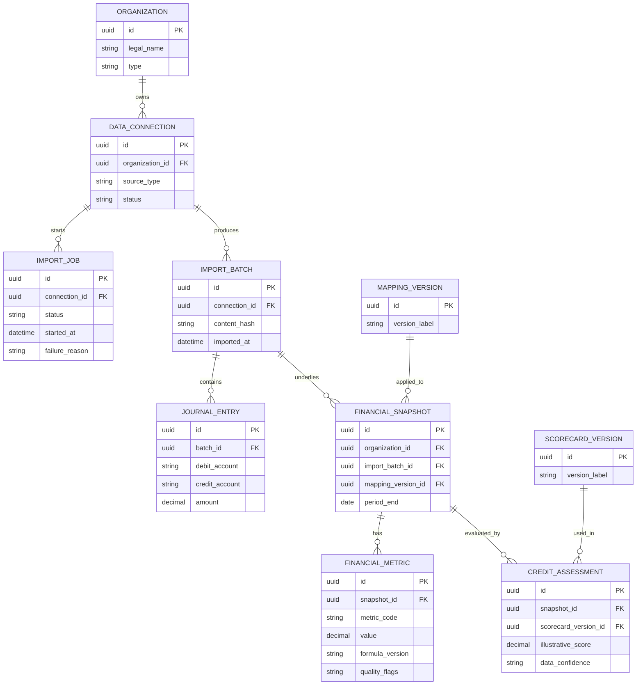

## 09. Entity Relationships — Access and Lending

Conceptual model for organizations, publication permissions, applications, immutable offers and audit records.

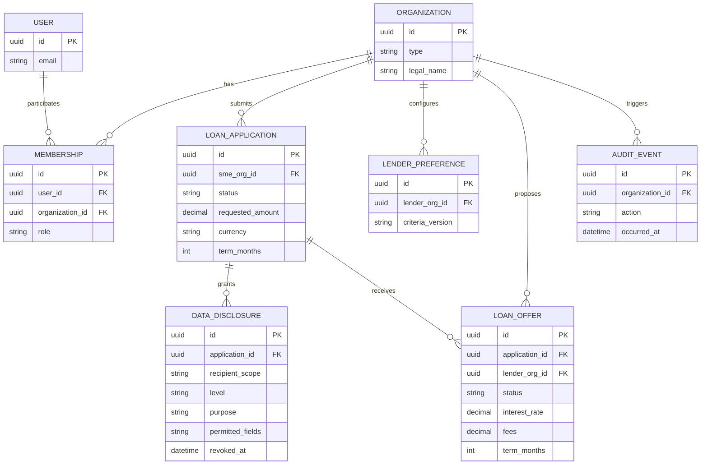

## 10. State Machine — Accounting Import Job

Manual retry creates a new job; unfinished jobs are failed on single-process startup.

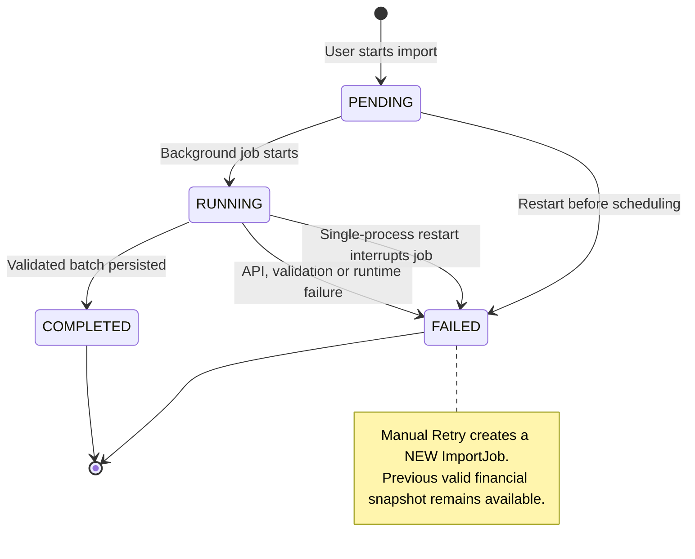

## 11. State Machine — Loan Application

Offers-received is a derived UI state, not a stored application status.

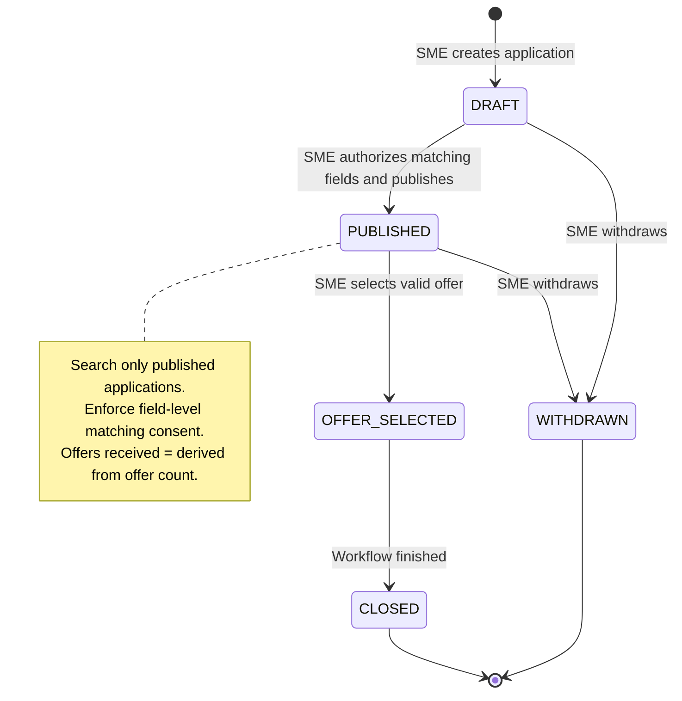

## 12. State Machine — Loan Offer

Immutable offer terms; only an authorized SME can select; at most one SELECTED per application.

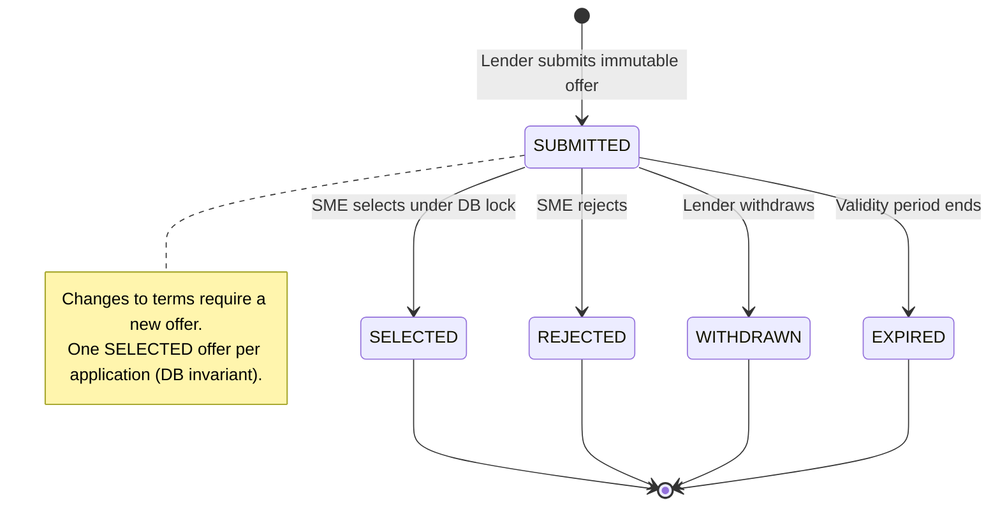

## 13. Privacy Decision Flow — Matching Eligibility

Prevents indirect disclosure through filters, ranking, results, and counts.

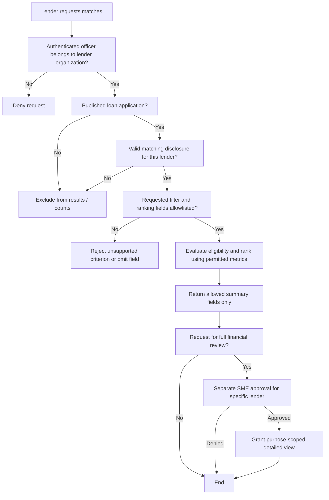

## 14. Master Product Roadmap and Dependencies

Product milestones; validation can run in parallel with implementation.

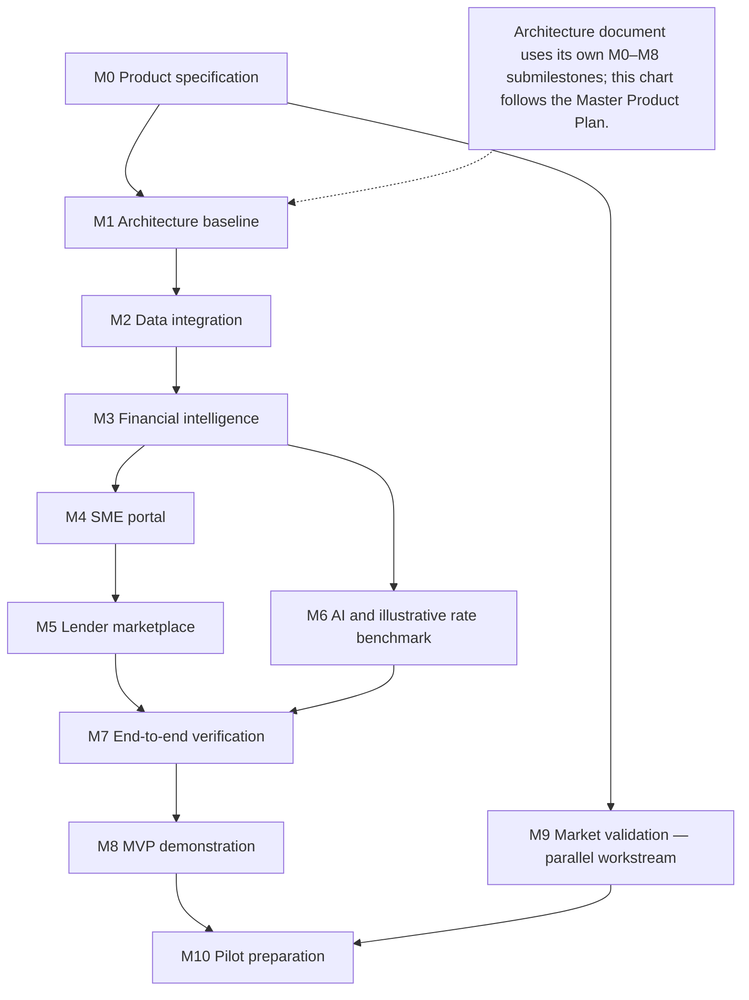

## How to use

1. Open this `.md` file in VS Code Markdown Preview with Mermaid support, or view it in a GitHub repository that renders Mermaid code blocks.
2. To edit an individual diagram, use its `.mmd` source file, or paste the Mermaid block into [Mermaid Live Editor](https://mermaid.live/).
3. Keep the diagrams synchronized with ADRs, API contracts, and the implementation. Revise the sequences if bexio integration feasibility or permissions differ from current assumptions.
