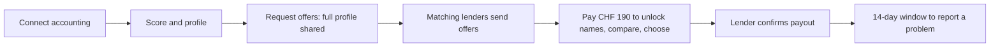
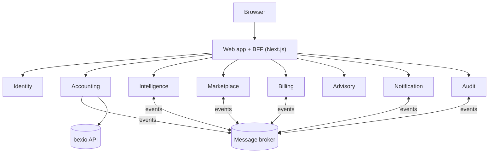

<div align="center">

# CredSort

**One profile. Many lenders. Your best rate.**

A Swiss marketplace where small and medium-sized companies (SMEs) get comparable loan offers from banks and other lenders, based on their real accounting data.

FinTech Certificate Programme · University of St. Gallen (HSG)

</div>

---

## Why CredSort

Swiss SMEs usually ask one or two banks for credit, with little idea what a fair rate is. Lenders, in turn, spend time on applications that never fit their book.

CredSort turns a company's accounting data into one standardised financing profile. Matching lenders see the full profile and send offers. The company compares them (anonymously at first), unlocks the lender names for a one-off fee, and picks the one with the lowest total cost.

| For companies | For lenders |
|---|---|
| Connect accounting (bexio) once, get a transparent credit-health score | Only see companies that match your own criteria |
| Try what-ifs: how would lower costs or less debt change the score? | Standardised, verified figures instead of PDF piles |
| Share your full profile only with lenders that match, stop sharing any time | Filter on the complete profile with your own criteria |
| Compare offers by **total cost**, including all fees | Simple offer flow, payout confirmation, clear pipeline |
| **Free to sign up. One-off CHF 190 per request** to unlock lender names (covers the identity check) | **Success fee** only when a loan is paid out |

## How it works



- CredSort **never handles loan money**. Lenders pay out directly.
- The company pays a **one-off CHF 190** per request (TWINT, Visa or Mastercard; the demo gateway only simulates success). Lenders pay a success fee, fixed with a signed quote at offer time and payable after the 14-day window; it is never added to the company's cost.
- Matching uses the profile the company disclosed. Fees never influence ranking.

## Architecture

Service-based architecture with event-driven integration, chosen for confidentiality, data integrity and evolvability. Details in [docs/architecture](docs/architecture/README.md) and [32 architecture decision records](docs/adr/README.md).



| Service | Responsibility |
|---|---|
| **identity** | Organisations, members, verification, accountant delegation, short-lived context tokens |
| **accounting** | Accounting connections (bexio, demo data) and background imports |
| **intelligence** | Financial data pipeline: mapping, metrics, scorecard, what-if scenarios |
| **marketplace** | Loan requests, consent, frozen published profiles, matching, offers, payout and disputes |
| **billing** | Price books, signed fee quotes, charges (exactly as quoted), the company unlock payment and its gateway |
| **advisory** | Plain-language explanations and the company assistant (Groq LLM, template fallback); replies with invented numbers are discarded |
| **notification** | In-app notifications without financial values |
| **audit** | Tamper-evident (hash-chained) activity log |

Key properties: one database per service, row-level security for every tenant table, transactional outbox and idempotent inbox, money as exact decimals, contracts generated and checked in CI ([contracts/](contracts)).

**Tech stack:** Python · FastAPI · PostgreSQL · RabbitMQ · Keycloak · Next.js · TypeScript

## Getting started

Requirements: Python 3.11+, Node.js 20+. No Docker needed for local development.

**1. Install**

```bash
python3 -m venv .venv
source .venv/bin/activate
pip install -e "libs/credsort-common[test]" pgserver
cd web && npm install && cd ..
```

**2. Optional: enable the AI assistant.** Create a local, git-ignored `.env` from the example and add your own Groq key (without it the assistant uses built-in answers):

```bash
cp .env.example .env
```

**3. Start the backend** (embedded PostgreSQL, all services, demo data)

```bash
python scripts/dev_up.py
```

Wait for `seed done`.

**4. Start the web app** (second terminal)

```bash
cd web && npm run dev
```

Open **http://localhost:3000**. Sign in with an account you create (password sign-up for companies, lenders and accountants), or use the **Demo** link for one-click, pre-made synthetic companies and lenders.

### Demo walkthrough

| Step | Sign in as | Do |
|---|---|---|
| 1 | Create a company account (or Anna Keller) | Add demo accounts, request offers |
| 2 | Sandra Huber (lender) | Open the match, send an offer |
| 3 | The company | See anonymous offers, pay the demo CHF 190, see names, choose one |
| 4 | Sandra Huber | Confirm the payout |
| 5 | The company | See the 14-day window; ask the assistant how to improve the rating |
| 6 | CredSort Operations | Review charges and pricing |

Also try Marco Rossi (accountant) to work on behalf of a client company.

**Reset demo data:** stop the backend, delete `.dev/pg`, start it again.

## Tests

```bash
# unit tests per service
for d in libs/credsort-common services/*; do (cd $d && PYTHONPATH=$PWD python -m pytest -q); done

# architecture fitness functions, contract drift and end-to-end (backend must be running)
python -m pytest tests -q
```

Regenerate API and event contracts after interface changes: `python scripts/gen_contracts.py`.

## Project structure

```
services/        8 backend services (FastAPI), each with its own migrations and tests
libs/            shared technical library (outbox/inbox, tokens, RLS sessions, resilient HTTP)
web/             Next.js web app and BFF
contracts/       generated OpenAPI and event schemas
tests/           architecture fitness functions and end-to-end tests
scripts/         local stack, demo seed, contract generation
deploy/          Docker Compose, Keycloak and RabbitMQ configuration
docs/            architecture views and ADRs
```

## Status

MVP under development.

- **Working and tested locally:** all services, the end-to-end loan flow, the web app for companies, lenders, accountants and operators.
- **Not yet tested:** the Docker Compose deployment, RabbitMQ, Keycloak sign-in (a dev login stands in), the live bexio connection, a real payment provider and identity partner (demo stand-ins are used).
- **Before real data:** the LLM provider receives the company's aggregate figures, so it needs a data-processing agreement and a region check; demo data only until then.
- **Open decisions:** whether CHF 190 is final and the lender fee share (a labelled demo price book is used), legal review (nFADP, AML, credit intermediation).

## Documentation

- [Architecture overview](docs/architecture/README.md)
- [Architecture decision records](docs/adr/README.md)
- [Product and development plan](docs/CredSort_Master_Product_Development_Plan_EN_v1.md)
- [Architecture and implementation plan](docs/CredSort_Architecture_Implementation_Plan_EN_v1.md)
