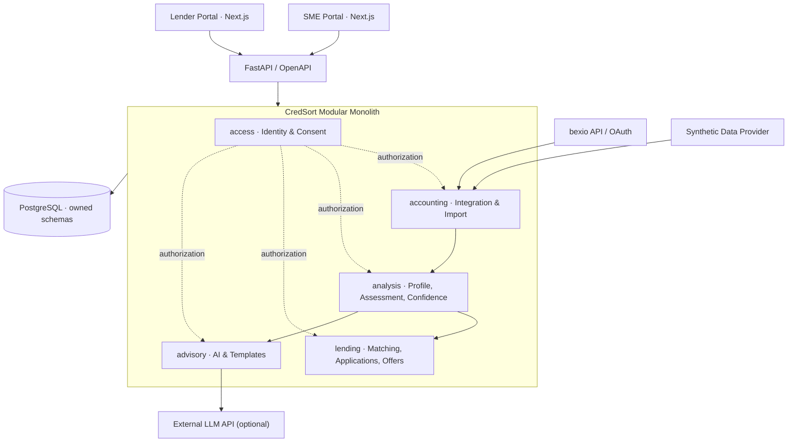
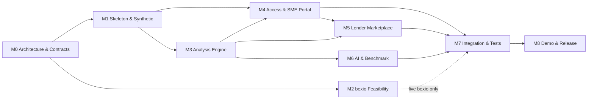

# CredSort — Architecture Baseline & Implementation Plan v1.0

**Date:** November 18, 2026  
**Status:** Proposed for team approval  
**Basis:** `CredSort_MVP_architecture.md` dated November 18, 2026, the subsequent architecture review, and agreed refinements  
**Team:** 2 developers using Codex / AI-assisted development  
**Planning:** Milestone-based, with explicit completion criteria, **without a three-day deadline**

> **Update 2026-11-19:** The decisions in this plan are now recorded as ADRs in [`docs/adr/`](adr/README.md), with the architecture review in [`docs/architecture/`](architecture/README.md). Where they differ, the ADRs take precedence. Main changes: a sixth module, `billing` (SMEs will be charged); re-ranked driving characteristics; new ADRs on authentication, tenant isolation, money handling, neutrality and the money flow.

> **Purpose of this document.** To establish the architectural decisions and turn them into a sequential implementation plan for a working CredSort MVP. This is not a production specification for a regulated lending service, nor a promise of validated bank-grade credit scoring. Any unverified assumptions about bexio, banking APIs, or data availability must be tested experimentally.

---

## 1. Product Goal and MVP Scope

**CredSort** is a two-sided platform connecting Swiss SMEs with potential lenders. An SME connects accounting data (primarily through **bexio**) and receives a standardized financial profile and preliminary assessment; lenders search **published loan applications that have been authorized for matching**, using configurable criteria, and submit offers. An AI Advisor explains financial indicators and helps explore scenarios for improving a company's financial position. The **fair-rate benchmark** remains part of the product concept, but the MVP does not present it as an empirically established “fair interest rate.”

### 1.1 Required End-to-End Scenario

1. An SME creates a company profile.
2. It connects a bexio sandbox account **or** selects the Synthetic Data Provider.
3. CredSort imports and validates the data, then creates a versioned financial snapshot.
4. The system calculates financial metrics, a preliminary Financial Assessment, and a separate Data Confidence measure.
5. The SME creates a loan application and **separately authorizes** publication and the use of specific fields for matching.
6. A lender sets hard eligibility criteria and preference weights; it sees only applications authorized for discovery.
7. The lender submits a demonstration offer with immutable terms.
8. The SME compares offers and selects one; the system retains the transaction history.
9. The AI Advisor explains verified metrics and can explain a deterministic what-if scenario.

**Mandatory for a working MVP:** both portals, synthetic yet internally consistent accounting data, Financial Profiling, transparent scoring, access control, matching, offers, and end-to-end tests.  
**Integration target:** a working bexio sandbox adapter, provided that the sandbox actually exposes the necessary data and permissions.  
**Outside MVP scope:** issuing real loans, transferring funds, making a bank's lending decision, production banking APIs, a probability-of-default (PD) model trained on actual defaults, and use of real personal or commercially sensitive financial data without an appropriate legal basis.

---

## 2. Architectural Principles and Decisions

### 2.1 Key Architecture Characteristics

| Priority | Characteristic | How it is verified / supported |
|---|---|---|
| ★ | **Data integrity** | `Decimal`, accounting invariants, versioned snapshots/rules/scorecards, reproducibility |
| ★ | **Security & confidentiality** | Tenant isolation, explicit consent for matching/disclosure, centralized server-side checks |
| ★ | **Simplicity** | Modular Monolith, one backend and PostgreSQL, no unnecessary distributed components |
| — | Testability | Pure financial functions, Synthetic Adapter, unit/integration/end-to-end tests |
| — | Interoperability | Anti-Corruption Layer (ACL) for bexio, canonical financial model, OpenAPI |
| — | Fault tolerance | Timeouts, bounded retries, last successful profile retained, offline demo |
| — | Evolvability | Public module interfaces, single table ownership, fitness functions |

### 2.2 Architectural Style, Deployment, and Communication

- **Modular Monolith:** one FastAPI backend containing five domain modules in a single process/codebase.
- **Ports & Adapters:** primarily for external accounting sources and the LLM; avoid interfaces introduced merely for their own sake.
- **One PostgreSQL database:** a separate schema per module is a desirable organizational measure; it **does not** replace authorization checks.
- **Next.js + TypeScript** for the SME and Lender Portals; **FastAPI + Python** for the API and domain logic.
- **Resource-oriented HTTP/JSON API** with OpenAPI; **do not call the API fully REST-conformant** unless all REST constraints, including HATEOAS, are implemented.
- **Synchronous in-process calls** for short operations; **asynchronous import jobs + polling** for long-running bexio requests.
- **No event broker, Redis, Kubernetes, GraphQL, service mesh, API gateway, or microservices** without a demonstrated need.
- **Docker Compose:** `frontend`, `backend`, `postgres`; as import load grows, a worker from the same application may run in a separate process, but not as a separate business service.
- In ASSE terms, this represents **one architectural quantum in the sense of coordinated deployment**, not a claim that all components fail independently.

### 2.3 Context Diagram



> The logical arrows `analysis → lending` and `analysis → advisory` indicate downstream dependencies in the model. In practice, downstream modules call the **owner's public interface** to obtain authorized data; they do not read other modules' tables directly.

---

## 3. Five Modules and Responsibility Boundaries

| Module | Responsibilities | Data owned | Must not do |
|---|---|---|---|
| `access` | Organizations, Memberships, authentication/authorization, DataDisclosure, AuditEvents | Users, organizations, permissions, audit records | Calculate financial metrics |
| `accounting` | DataConnection, bexio/Synthetic adapters, imports, canonical ledger, ImportJob states | Connections, jobs, source data in normalized form | Assign bank credit ratings |
| `analysis` | FinancialSnapshot, account mapping, ratios, scorecard, Data Confidence, deterministic what-if scenarios | Snapshots, metrics, assessments, calculation versions | Apply a specific lender's preferences |
| `lending` | LoanApplication, LenderPreference, eligibility, Match Ranking, LoanOffer, offer comparison | Applications, criteria, offers | Read other modules' raw journal entries or change Financial Assessments |
| `advisory` | Explanation of completed assessments, financial recommendations, LLM/templates | No required MVP tables | Calculate/change scores or make lending decisions |

**There are five modules, not seven.** `Financial Profiling + Credit Assessment` are combined within `analysis`; `Marketplace + Loan Management` are combined within `lending`. They nevertheless remain **distinct internal components with separate test suites**. `access` serves as the single policy authority, but checks must be enforced **in every relevant application service**, not merely in the UI or an API gateway.

**Dependency direction:** `accounting` does not depend on `analysis`; `analysis` does not depend on `lending`; `advisory` does not mutate `analysis` domain state. External data formats do not escape the `accounting`/`advisory` adapters. Cross-module calls use public `api.py` interfaces and typed DTOs rather than importing another module's internal repositories.

### 3.1 Ports & Adapters

| Port | Implementations | Boundary |
|---|---|---|
| `AccountingDataProvider` | `BexioAdapter`, `SyntheticDataAdapter` | Both implementations return the same canonical financial model |
| `LanguageModel` | `LlmApiAdapter`, `TemplateAdapter` | The AI receives only prepared, authorized aggregates; the fallback works offline |

The “two adapters per port” approach is **a pragmatic heuristic for this MVP**, not a universal theorem of Hexagonal Architecture. A separate port can also be appropriate with a single adapter when it isolates a genuinely unstable dependency.

### 3.2 Proposed Repository Structure

```text
credsort/
  frontend/                     # Next.js, two portals, OpenAPI-generated client
  backend/
    credsort/
      main.py                   # composition root / DI
      shared/                   # Money(Decimal), DB session, errors, context
      access/                   # api.py, domain/, application/, adapter/
      accounting/               # api.py, domain/, application/, port/, adapter/
      analysis/                 # api.py, domain/ratios.py, scorecard.py, application/
      lending/                  # api.py, domain/matching.py, offers.py, application/
      advisory/                 # api.py, port/language_model.py, adapter/
    tests/
      unit/
      integration/
      e2e/
      architecture/
  demo_data/                    # synthetic bookkeeping data (no real clients)
  docs/
    adr/
    api/
    financial-methodology.md
    bexio-feasibility.md
  docker-compose.yml
  README.md
```

---

## 4. Data, Accounting Model, and Reproducibility

### 4.1 Data Ownership

| Schema / module | Main entities |
|---|---|
| `access` | `Organization`, `User`, `Membership`, `DataDisclosure`, `AuditEvent` |
| `accounting` | `DataConnection`, `ImportJob`, `CanonicalAccount`, `JournalEntry`, `ImportBatch` |
| `analysis` | `FinancialSnapshot`, `FinancialMetric`, `CreditAssessment`, `ScorecardVersion`, `MappingVersion` |
| `lending` | `LoanApplication`, `LenderPreference`, `LoanOffer` |
| `advisory` | Stateless in the MVP; if necessary, technical logs only, without raw financial data |

**Single table ownership:** only the module that owns a table writes to it; other modules use its public application API. If one DB role has access to all schemas, the boundary is **enforced at the code level, not a hard database security boundary**. Separate database roles may be considered later.

### 4.2 Canonical Model

Raw bexio payloads are never used directly for scoring. Data moves through the following stages:

`Source payload → validated canonical entries → accounting mapping → verified snapshot → metrics → assessment`

For each metric, store at least: `company_id`, `period_start/end`, `currency`, `value`, `unit`, `source_import_id`, `mapping_version`, `formula_version`, `computed_at`, `quality_flags`, and availability status. For each assessment, store: `snapshot_id`, `scorecard_version`, `assessment_version`, and explanatory factors.

**Important:** do not assume in advance that the bexio API provides complete ready-made P&L statements, balance sheets, banking transaction history, or DSCR. Verify the relevant endpoints, scopes, pagination, opening balances, chart of accounts, period closing entries, and data completeness in the sandbox. If a metric cannot be calculated, mark it `unavailable`, **not 0**.

### 4.3 Minimum Financial Metrics

| Metric | Source / calculation | Limitation |
|---|---|---|
| Revenue, growth | P&L for comparable periods | Verify periods and accounting policies |
| EBITDA margin | Income/expenses after proper classification | Cannot always be reconstructed unambiguously from journal entries |
| Equity ratio | Equity / Assets | Requires correct balances and balance checks |
| Current ratio | Current Assets / Current Liabilities | Requires maturity classification |
| Debt / EBITDA | Financial debt / EBITDA | Do not confuse with Debt-to-Equity; verify debt figures |
| Receivables aging | Outstanding invoices + due dates | Requires reliable dates and payment status |
| DSCR | Cash available for debt service / debt service | **Do not calculate** if cash-flow or debt-obligation data is incomplete |

**Validation:** debits = credits, assets = liabilities + equity (with appropriate closing entries), consistency across periods, currencies, missing fields, duplicates, and negative/anomalous values. Monetary calculations in the domain use `Decimal`; pandas is acceptable in exploratory notebooks but is neither required nor needed for domain formulas.

### 4.4 Financial Assessment, Data Confidence, and Matching Are Separate Concepts

1. **Financial Assessment:** a transparent, predefined **demonstration** scorecard; its score is neither an estimated probability of default nor a recognized bank credit rating.
2. **Data Confidence:** completeness, freshness, verifiability, and quality of the underlying information; do not conflate it with financial strength.
3. **Lender Matching:** first apply hard eligibility criteria (industry, loan size/term, metric thresholds), then preference ranking based only on authorized fields. Lender-specific weights **do not change** the Financial Assessment.

### 4.5 Fair Rate Benchmark — Open Product/Architecture Contract

For the MVP, an **illustrative rate range** may be displayed using synthetic data or clearly stated assumptions; it must not be presented as an actually observed “fair market rate.” Before implementation, specify the contract `RateEstimateInput → (range, assumptions, sources, version, confidence)` and its input fields: loan amount/term, collateral, product/repayment structure, assessment, and lender-offer terms. Real calibration requires external data on interest rates and comparable credit transactions. In the absence of such data, label the feature **illustrative** or defer it.

---

## 5. Transactions, Imports, and Resilience

### 5.1 Transaction Boundaries

**The top-level application service opens one transaction per local use case.** Other modules' public `api.py` interfaces and repositories receive the same unit of work / DB session and **do not call `commit()` themselves**. Long-running network operations are performed **outside** database transactions.

| Use case | Atomic boundary / guarantees |
|---|---|
| Register Connection | Persist DataConnection and the associated permission/status |
| Import | Fetch bexio pages outside a DB transaction; after validation, atomically persist ImportBatch + canonical entries |
| Create Snapshot | Persist snapshot + metrics + versions and quality flags consistently; assessment may run separately |
| Assess | Atomically persist assessment version and references to the immutable snapshot/scorecard |
| Publish Application | Check ownership, create/publish the application, and record matching consent as one consistent operation |
| Select Offer | `SELECT ... FOR UPDATE` or optimistic locking, validate state and permissions, select exactly one offer + audit |

**Required invariant:** no more than one `SELECTED` offer per loan application. Enforce it with a database constraint/partial unique index or equivalent serialization, preferably with both layers of protection. Offer terms are immutable after submission: revised terms require a new offer.

### 5.2 Background Import — Broker-Free, with Recovery

API:

- `POST /api/companies/{company_id}/import-jobs` → `202 Accepted`, `Location: /api/import-jobs/{job_id}`;
- `GET /api/import-jobs/{job_id}` → status, progress, error, links to results;
- the frontend polls at a reasonable interval and stops when a terminal state is reached.

**State machine:** `PENDING → RUNNING → COMPLETED | FAILED`. A manual retry creates a **new job**. Fields: `created_at`, `started_at`, `finished_at`, `failure_reason`, `source_connection_id`.

**MVP recovery:** when the single backend process starts, any remaining `PENDING/RUNNING` jobs are marked `FAILED` with reason `interrupted`; the user may start the import again. This deliberately uses simpler semantics than a heartbeat/lease-based scheduler. **If multiple workers or instances are introduced, this rule must be reconsidered** (otherwise one process could mark another process's active job as failed).

**Idempotency:** content hashes are useful for detecting identical versions, but are **not sufficient by themselves**. We need atomic writes, uniqueness constraints for snapshots/import fingerprints, prevention of concurrent active imports for the same connection, and safe re-imports. A normalization key can include `connection_id`, `period`, normalized content, and `mapping_version`. Do not publish a new profile before successful validation.

**bexio failures:** timeouts and bounded retries for 429/5xx, honoring `Retry-After` where provided; for 401/403, show a message asking the user to verify authorization/permissions instead of retrying indefinitely. Retain the latest validated snapshot and display its update date.

### 5.3 AI Failures

The LLM adapter limits request time and size, sanitizes context, and does not send raw journal entries or counterparties' personal data. An unavailable/failing API falls back to a `TemplateAdapter` with deterministic explanations. A circuit breaker may be introduced if operational problems are observed, but it is not mandatory for the first increment. What-if calculations are performed by the **deterministic financial model**; AI only explains the results.

---

## 6. Security, Confidentiality, and Consent by Design

### 6.1 Core Rule

**Connecting bexio does not imply consent to publication.** Lenders can access **only published loan applications** and **only the fields explicitly authorized by the SME for matching**. Even appearing in a filtered search result discloses information; therefore, filtering, sorting, or aggregates/counts that would allow hidden values to be inferred are prohibited when based on unauthorized fields.

### 6.2 Minimum DataDisclosure Model

| Field | Purpose |
|---|---|
| `application_id` | Identifies the application covered by the permission |
| `recipient_scope` | All authorized lenders or a specified lender |
| `level` | `summary` / `full` |
| `purpose` | `matching` / `application_review` |
| `permitted_fields` | **Required addition:** allowlist of fields available for filtering/display |
| `revoked_at` | Time of revocation, if any (nullable) |

`expires_at` and complex reauthorization workflows can be deferred. When publishing an application, the SME sees which metrics will be disclosed. `full` access is granted only following separate confirmation for the specific lender/interest. `access.api.can_view(...)` and a separate `can_filter(field, application, lender)` check are enforced server-side.

**Revocation:** after `revoked_at`, new reads and matching are prohibited. Revocation does not guarantee deletion of copies previously transmitted to a lender; this must be explained to users and addressed in future agreements.

### 6.3 Data Access and Audit

- Check both **the user's organization membership** and **that organization's permission for the resource** on the server, including list/search, details, export, offers, and what-if functionality.
- Secrets and bexio OAuth tokens are not stored in plaintext; use minimum scopes and HTTPS outside the local development environment, and exclude secrets from logs.
- For critical state-changing actions, create the audit event atomically within the shared transaction. Reads and denied access are also logged under an explicit policy, without recording sensitive values. If audit records are mandatory, define the behavior when audit writing fails.
- `summary/full` access levels do not replace field-level permission checks for search.
- Send only the minimum necessary aggregated data to an external LLM; use **synthetic** data in the MVP.
- Real-data use requires separate verification of access rights, contractual grounds, and applicable Swiss legal obligations; this architecture plan is not a substitute for legal review.

---

## 7. API Contracts and Marketplace Lifecycle

### 7.1 Example Resource-Oriented CredSort Endpoints (To Be Finalized in OpenAPI)

| Method / path | Purpose |
|---|---|
| `POST /api/companies` | Create an SME profile |
| `POST /api/companies/{id}/data-connections` | Register a data connection |
| `POST /api/companies/{id}/import-jobs` | Start an import (202) |
| `GET /api/import-jobs/{id}` | Check results/errors |
| `GET /api/companies/{id}/financial-profiles/current` | Retrieve current validated snapshot/metrics |
| `POST /api/companies/{id}/assessments` | Create a reproducible assessment |
| `POST /api/loan-applications` | Create a loan application |
| `POST /api/loan-applications/{id}/publication` | Publish + authorize matching fields |
| `PUT /api/lenders/{id}/preferences` | Replace a lender's criteria |
| `GET /api/lenders/{id}/matches` | Search **only authorized** published applications |
| `POST /api/loan-applications/{id}/offers` | Submit a lender offer |
| `POST /api/loan-offers/{id}/selection` | SME selects an offer (with state validation) |
| `POST /api/companies/{id}/scenarios` | Run a what-if scenario without changing the original snapshot |
| `GET /api/companies/{id}/advice` | AI/template explanations |

Contracts must define 401/403/404/409/422 error handling, idempotency for repeatable mutation calls, request/response schemas, authorization, and `Cache-Control: no-store` for sensitive responses. The exact OAuth callback is determined after registration in the bexio sandbox. All paths above are **proposed CredSort endpoints**, not documented bexio endpoints.

### 7.2 Application and Offer States

**LoanApplication:** `DRAFT → PUBLISHED → OFFER_SELECTED → CLOSED`, with `WITHDRAWN` permitted from open states. Do **not** persist `OFFERS_RECEIVED`: derive it from the existence/count of offers.

**LoanOffer:** `SUBMITTED → SELECTED | REJECTED | WITHDRAWN | EXPIRED`. Terms (`amount`, `rate`, `term`, `fees`, `collateral`, `amortization`) are immutable after submission; changed terms create a new `LoanOffer`/version. Only the SME can select an offer; the lender can submit or withdraw its own offer.

Before selection, verify that the application is published and not closed, that the offer belongs to the application and has neither expired nor been withdrawn, and that the initiating user is an authorized SME representative. Invalid or conflicting transitions return `409 Conflict`.

---

## 8. Architectural Fitness Functions and Verification Plan

| Check | Type | Minimum completion criterion |
|---|---|---|
| Architectural import rules | CI / static | `domain/` does not import FastAPI, SQLAlchemy, or adapters; cross-module access uses only public APIs |
| Accounting invariants | Unit | Correct debits/credits, balance checks, controlled missing fields, Decimal |
| Reproducible assessments | Unit/integration | The same immutable snapshot and mapping/formula/scorecard versions reproduce the same result |
| Tenant isolation | API integration | Another tenant's `FinancialSnapshot` is inaccessible even by direct ID |
| **Indirect disclosure** | API integration | Search, count, ranking, and filters do not expose unpublished applications or unauthorized fields |
| Offer concurrency | DB integration | Two concurrent selections cannot produce two `SELECTED` offers |
| Import recovery | Integration | Process failure → unfinished job marked interrupted/FAILED; manual retry is safe |
| Import idempotency | Integration | Duplicates, repeated submissions, and parallel imports do not corrupt data |
| External failures | Integration | bexio 429/5xx/timeouts and AI timeouts lead to controlled errors/fallbacks |
| End-to-end | Playwright | SME → profile → assessment → publication → matching → offer → selection |
| Basic performance | Targeted | Dashboards and filters run on a small synthetic dataset without noticeable degradation; measurements are retained |

**CI:** `ruff`/type checking, pytest, import-linter, migration checks; frontend type checking and core Playwright scenarios. JMeter/load tests are used when needed, rather than solely to accumulate metrics.

---

## 9. Architectural Implementation Milestones (No Calendar Deadline)

The work below is organized into **dependent milestones**, not promised delivery dates. The two-person team can work on technically independent tasks in parallel, but each milestone must close with reproducible results.

### M0 — Architecture Freeze & Contracts

**Tasks:** approve the five modules; refine `FinancialSnapshot`, `CreditAssessment`, `DataDisclosure`, and `LoanOffer`; resolve open questions about data sources and permissions; create ADRs; describe the main use case; agree on API schemas.  
**Deliverables:** Architecture Baseline, context map, entity glossary, initial OpenAPI, ADR register, backlog.  
**Definition of Done:** both developers agree on the same data types, ownership, state transitions, and public interfaces.  
**Dependencies:** none.

### M1 — Project Skeleton & Synthetic Path

**Tasks:** create the GitHub repository, Docker Compose setup, FastAPI/Next.js/PostgreSQL applications, migrations, and CI; create the `SyntheticDataAdapter` and three internally consistent SME datasets with different risk profiles; introduce basic import tests.  
**Deliverables:** application starts with a single command; mock ledger → canonical data.  
**Definition of Done:** the project runs on both developers' machines; tests pass without network access or bexio.  
**Dependencies:** M0.

### M2 — bexio Feasibility & Accounting Integration

**Tasks:** request a sandbox at the very start of the project; experiment with OAuth/PAT as permitted by the current documentation; check scopes, endpoints, pagination, and rate limits; reconcile reconstructed statements against the test-account ground truth; implement the normalizing adapter, ImportJob lifecycle, and idempotency.  
**Deliverables:** `bexio-feasibility.md`, API fixtures, `BexioAdapter`, import-status UI.  
**Definition of Done:** document exactly which financial data can be obtained; complete a successful test import **or** document the blocker while retaining a fully working synthetic path.  
**Dependencies:** M0; can proceed in parallel with M1/M3.

### M3 — Financial Analysis & Scoring Engine

**Tasks:** canonical mapping, accounting invariants, snapshots, ratio calculations, predefined demonstration scorecard, Data Confidence, `MappingVersion`/formula/scorecard versioning, deterministic what-if calculations, and unit tests.  
**Deliverables:** reproducible profiles and assessments for three SMEs.  
**Definition of Done:** correct formulas, clear `unavailable` flags, controlled recalculation by version, and **no claim of a real probability of default (PD)**.  
**Dependencies:** M1; M2 is needed only for the bexio-driven path.

### M4 — Access, Consent & SME Portal

**Tasks:** Organizations, Memberships, tenant checks; dashboard, data-source connection UI, import status, applications, publication/disclosure controls, and indirect-disclosure tests.  
**Deliverables:** an SME can independently create, review, and publish an authorized application.  
**Definition of Done:** connecting bexio does not automatically publish data; authorization is enforced on the server.  
**Dependencies:** M1 and M3; the basic `access` module should ideally begin alongside M1.

### M5 — Lender Matching & Offer Lifecycle

**Tasks:** LenderPreferences, eligibility vs. ranking; filtering based solely on authorized fields; immutable offers; comparison; selection concurrency controls.  
**Deliverables:** Lender Portal, distinct matching results for different criteria, at least two offers, and SME selection.  
**Definition of Done:** no disclosure of other tenants' or unpublished data; simultaneous selections cannot both succeed; submitted offer terms cannot be overwritten.  
**Dependencies:** M3 and M4.

### M6 — AI Advisor & Benchmark Prototype

**Tasks:** implement `LanguageModel` and templates; explanations using validated metrics; what-if explanations; graceful degradation; define the `RateEstimate` contract and, only if supported by defensible data, an illustrative rate range.  
**Deliverables:** AI Advisor, template fallback, documented benchmark assumptions.  
**Definition of Done:** the LLM neither calculates nor modifies scores; no raw accounting data or unnecessary identifiers are sent to the external provider; at least one what-if scenario is handled correctly.  
**Dependencies:** M3; UI integration depends on M4.

### M7 — System Integration, Fault/Security Testing

**Tasks:** end-to-end tests, simulated 429/timeouts, transaction races, recovery, access probes, reproducibility, bug fixes, and basic execution-time metrics.  
**Deliverables:** passing CI, test report, documented known limitations.  
**Definition of Done:** the complete core scenario runs without manual SQL edits; there are no known critical access-control or accounting defects.  
**Dependencies:** M4–M6 (M2 only if live bexio is included).

### M8 — Release & Demonstration

**Tasks:** live/offline modes, deterministic seeds/fixtures, demo backup, scripted walkthrough, architecture diagram/ADR overview, README, licensing/security disclaimers.  
**Deliverables:** reproducible MVP, startup instructions, demo script, architecture/test documentation.  
**Definition of Done:** a third person can deploy the system following the README and complete the SME → lender → offer workflow, clearly seeing which integrations are real and which activities use synthetic simulation.  
**Dependencies:** M7.

### 9.1 Dependency Graph



### 9.2 Division of Work Between Two Developers

| Track A | Track B | Shared responsibilities |
|---|---|---|
| Backend skeleton, accounting adapter, data model, financial formulas, import jobs | Frontend, SME/Lender workflows, matching UI, offers, AI presentation | Architecture freeze, OpenAPI contracts, scoring assumptions, PR review, security, end-to-end testing |

The suggested division does not mean that either developer alone validates financial formulas or security. **The second team member reviews every pull request that changes the financial model or access controls.** Codex generates implementation code; it does not make architectural or financial decisions on behalf of the team.

---

## 10. ADR Register (Short Decisions, Not Long Essays)

| ADR | Topic | Status |
|---|---|---|
| ADR-0001 | Modular Monolith vs. microservices / distributed event-driven architecture | Proposed |
| ADR-0002 | Five domain modules, integrators/disintegrators | Proposed |
| ADR-0003 | Ports & Adapters for bexio and LLM | Proposed |
| ADR-0004 | Single PostgreSQL database, table ownership, public module APIs | Proposed |
| ADR-0005 | Synchronous use cases + background import & polling | Proposed |
| ADR-0006 | Resource-oriented HTTP/JSON (no claim of full REST compliance) | Proposed |
| ADR-0007 | External API timeouts, retries, fallback | Proposed |
| ADR-0008 | Consent and permitted-field matching | Proposed |
| ADR-0009 | AI only explains deterministic financial results | Proposed |
| **ADR-0010** | **Background Import Recovery & Idempotency** | **New** |
| **ADR-0011** | **Transaction Boundaries & Offer Concurrency** | **New** |

Each ADR follows: **Context → Alternatives → Decision → Consequences → Revisit trigger**. After team confirmation, change `Proposed` to `Accepted`. Prefer short, testable decisions.

---

## 11. Open Questions and Go/No-Go Decisions

| Question | How to resolve it | Affects |
|---|---|---|
| Which fields and scopes are actually available through the bexio sandbox? | Real API requests, test account, documentation, sample ledger | M2, M3 |
| Can a Balance Sheet/P&L be reconstructed from the API without manual uploads? | Reconcile imported results against test-account reports | Canonical Model, Data Confidence |
| How are non-standard charts of accounts handled? | Mapping version + test cases; manual validation if needed | M3 |
| Which fields does an SME authorize for matching? | Product decision + field allowlist + access tests | M4/M5 |
| Which scorecard is acceptable as a demonstration? | Financial methodology, thresholds, minimum data completeness, review | M3 |
| Is the Rate Benchmark needed for the demo? | Either illustrative assumptions + warning, or defer | M6/M8 |
| What is the policy for access to a full loan application? | Separate SME authorization for a particular lender | M4/M5 |
| Is a separate queue/worker necessary? | Only if measured concurrent import load/restarts justify it | Operations |
| What are the actual course deadlines and demo requirements? | Confirm separately; the architecture is not currently deadline-driven | Prioritization |

**Rule:** a blocker in an external API integration must not block the synthetic end-to-end MVP; document the issue rather than disguising a simulated connection as “live.”

---

## 12. Risks, Trade-offs, and Revisit Conditions

| Risk | Consequence | Mitigation |
|---|---|---|
| bexio API does not expose required data/scopes | Incomplete profile | Early feasibility check, Synthetic Adapter, explicit missing-data status |
| Incorrect account mapping | Incorrect score | Mapping version, reconciliation, control ledger, review |
| Information leakage through lender filters/counts | Breach of confidentiality | Published-only search, field allowlist, authorization tests |
| Inconsistent offer/application states | Two selected offers | Transaction + lock/constraint + state machine |
| Backend restart during import | Unfinished task | Interrupted → FAILED, manual retry, atomic writes |
| AI invents financial metrics | Misleading advice | Deterministic scoring, structured context, templates, tests |
| Excessive architectural boilerplate | Slower development | Ports only where justified, short ADRs, incremental delivery |

**Revisit the Modular Monolith** only if there are measurable requirements for independent deployment, substantial import load, separate AI availability, or production banking integrations. Extracting a service will require more than replacing a function call with HTTP: it also introduces network resilience, data ownership, service authentication, distributed consistency, and deployment concerns.

---

## 13. Final Definition of Done for Architecture and MVP

### The Architecture Baseline Can Be Approved When:

- [ ] The five modules, their public APIs, data ownership, and dependency directions are agreed upon.
- [ ] Transaction boundaries and the offer-selection concurrency mechanism are approved.
- [ ] ImportJob recovery and idempotency are specified.
- [ ] Consent and field-level matching rules are approved.
- [ ] Snapshot, mapping, formula, and scorecard versions are defined.
- [ ] The distinctions `demo score ≠ validated PD` and `illustrative rate ≠ observed market rate` are explicitly documented.
- [ ] ADR-0001 through ADR-0011 have statuses and owners.

### The MVP Can Be Called Working When:

- [ ] The entire workflow from the SME to offer selection works with synthetic data.
- [ ] The financial profile is reproducible; accounting invariants and calculations pass tests.
- [ ] Lender A cannot infer information about another tenant's or unpublished company through any endpoint or filters.
- [ ] A lender cannot accept an offer on an SME's behalf; conflicting concurrent selections are safely rejected.
- [ ] AI fallback and the offline demo work without external services.
- [ ] If bexio is presented as integrated, it genuinely reads available sandbox data and its limitations are documented.
- [ ] Source code, migrations, seed data, README, ADRs, and the test report make the demonstration reproducible.

---

## 14. First Practical Actions

1. **Approve this baseline together** and list 5–10 specific open questions that genuinely block implementation.
2. **Request a bexio sandbox immediately**, test authentication and accounting journal access; do not wait for the frontend to be finished.
3. **Agree on canonical DTOs and OpenAPI** before parallel code generation through Codex.
4. **Implement the synthetic `accounting → analysis` path first**, along with unit tests for financial calculations.
5. In parallel, create the `access` skeleton and the SME/Lender UI against the agreed contracts.
6. Next, add the marketplace workflow, offer-selection constraints, AI Adapter, and live bexio path.
7. Finish with integration/security/fault testing and a demo rehearsal.

**Conclusion:** retain the original CredSort architecture, strengthen the agreed areas, and build the product incrementally. The three-day time limit has been removed, but the principle of minimum necessary complexity remains.
