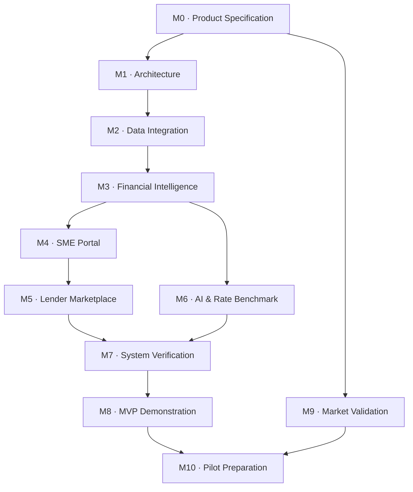

# CredSort — Master Product & Development Plan

**FinTech Certificate Programme · University of St. Gallen (HSG) · Working Plan v1.0**

> **Update 2026-11-19:** The team decided that **SMEs will be charged** (amount and trigger to be decided). This replaces "SME access: free" in §2.2. The software architecture (Stage 10) is now a service-based design documented in [`docs/architecture/`](architecture/README.md) and [`docs/adr/`](adr/README.md); see [ADR-0001](adr/0001-architecture-style.md) and [ADR-0013](adr/0013-billing-and-sme-charging.md).

This document brings together everything we have discussed about CredSort into **one overarching product and development plan**: not only software architecture, but also core features, the financial model, external integrations, user interfaces, the business model, testing, and demonstration preparation.

This master plan sits **above the Architecture & Implementation Plan** prepared separately. The architecture document answers *how we build the system*; this master plan defines *what we are building, for whom, in what sequence, and how we determine success*.

**Starting assumptions:** The professor has evaluated the concept positively. Two developers will build the product with extensive assistance from Codex. There is no longer a strict three-day development constraint. Our goal is a working MVP that can later evolve into a real FinTech product.

## 1. Final CredSort Product Concept

**CredSort is a Swiss FinTech platform connecting small and medium-sized enterprises (SMEs) with banks and other lenders. It automates the analysis of financial data through accounting integrations, produces standardized creditworthiness assessments, and helps SMEs find competitive financing terms.**

**Product promise:** *One Profile. Many Lenders. Your Best Rate.*

**SME side:** Connect accounting → Financial Profile → Credit Application → AI Advisor → Compare Offers.

**Lender side:** Define Credit Criteria → Match Applications → Assess Risk → Submit Loan Offers.

**CredSort core:** Financial Data · Assessment · Matching · Transparency · Advisory.

The platform has three potential sources of value:

1. **For SMEs:** Less paperwork, a clearer understanding of financial standing, and the ability to compare financing offers.
2. **For lenders:** Standardized data, lower costs of preliminary application screening, and more efficient discovery of potential borrowers.
3. **For CredSort:** An accumulating set of structured data on financial profiles, lender criteria, and actual offers that could eventually improve matching and interest-rate benchmarks.

The core economic rationale is the reduction of **information asymmetry and transaction costs** in SME lending.

## 2. Complete Overview of Core Product Features

We distinguish three levels of priority so that MVP essentials do not become confused with longer-term ambitions:

- **P0 — Core MVP:** Required for the initial end-to-end product.
- **P1 — Extended MVP:** Next iteration.
- **P2 — Commercial expansion:** Later product development.

| Feature | What the system should do | Priority |
|---|---|---|
| SME Registration & Profiles | Register companies and manage their profiles | P0 |
| bexio Integration | Connect accounting software through an API | P0 |
| Synthetic Data Import | Provide test data and a demonstration independent of third-party systems | P0 |
| Financial Data Processing | Normalize, validate, and calculate financial metrics | P0 |
| Financial Dashboard | Display the SME's financial condition | P0 |
| Credit Assessment | Produce an explainable preliminary assessment | P0 |
| Data Confidence | Assess the completeness and quality of source data | P0 |
| Loan Applications | Create and publish financing applications | P0 |
| Access & Consent | Control disclosure of information to lenders | P0 |
| Lender Dashboard | Provide an interface for banks and other lenders | P0 |
| Customizable Lender Filters | Configure criteria for selecting SMEs | P0 |
| Matching Engine | Match eligible loan applications to lenders | P0 |
| Loan Offers | Allow lenders to create financing offers | P0 |
| Offer Comparison | Compare interest rates and financing terms | P0 |
| AI Financial Advisor | Explain assessments and suggest improvements | P1 |
| What-if Analysis | Model changes in financial standing | P1 |
| Fair Rate Benchmark | Estimate an interest-rate range from comparable data | P1* |
| Fiduciary Portal | Support accounting and fiduciary intermediaries | P2 |
| Additional Accounting APIs | Add Abacus and other accounting systems | P2 |
| Banking / bLink Integration | Bring in additional banking data | P2 |
| Advanced Credit Risk Models | Introduce statistical models once sufficient data exist | P2 |
| Production Lender APIs | Integrate with lenders' operational systems | P2 |

*For a demonstration, an indicative rate model based on explicit assumptions is acceptable. An empirically grounded Fair Rate Benchmark requires market data not yet available to us.*

The P0 features are not meant to be developed simultaneously. Together, they form an end-to-end workflow that we will implement incrementally.

---

# Part I. Product, Market & Economic Model

## Stage 1. Product Definition & Requirements

**Objective:** Define the product, target audience, and user journeys precisely.

### 1.1. Define the Target Market

For the initial version, retain the selected segment:

- Swiss SMEs, primarily GmbH and AG companies.
- Companies already using an accounting system.
- Indicative financing needs of **CHF 100,000–1,000,000**.
- Banks, regional lenders, and non-bank financing institutions.

Decide whether to serve all sectors from the outset or begin with a narrower selection. Industry differences matter for credit analysis: ratios of manufacturing companies and IT companies should not automatically be interpreted in the same way.

### 1.2. Describe the Main User Journeys

We need three core journeys:

**SME Journey**  
Registration → Connect bexio → Financial Profile → Assessment → Credit Application → Lender Offers → Comparison.

**Lender Journey**  
Registration → Lending Criteria → Matching → Review Application → Submit Offer → Track Status.

**AI Advisory Journey**  
Financial Assessment → Identify Weaknesses → Recommendations → What-if Scenario → Updated Simulation.

Use these journeys to prepare functional requirements, user stories, and acceptance criteria.

### 1.3. Validate Key Assumptions

| Hypothesis | Validation method |
|---|---|
| SMEs are willing to connect accounting data | Interviews and prototype testing |
| Banks value standardized financial profiles | Interviews with credit specialists |
| Banks want to search applications using their own criteria | Interface demonstration and feedback |
| SMEs value an indicative rate assessment | Interviews with potential borrowers |
| Fiduciaries could be an effective acquisition channel | Discussions with Treuhänder / fiduciary firms |
| bexio supplies sufficient data for analysis | API feasibility test |

The last hypothesis is technical; the others concern product-market fit and commercial viability.

**Deliverables:** Product Requirements Document (PRD), User Journeys, Feature Backlog, MVP Scope.

## Stage 2. Business Model & Market Validation

**Objective:** Determine why CredSort could be economically viable.

### 2.1. Competitive Analysis

Study existing Swiss SME financing platforms, especially solutions such as Systemcredit, financing intermediaries, and direct digital bank lending channels.

Compare:

- Financial data sources.
- Degree of automation.
- Availability of preliminary credit scoring.
- Interest-rate transparency.
- Lender access to applications.
- Fees and business models.

Our **hypothesized** differentiator is: **standardized credit profiles + explainable assessments + customizable lender matching + independent comparison of offers**. This is a proposition to validate, not established market superiority.

### 2.2. Define the Revenue Model

The current pitch deck considered the following model:

| Parameter | Working assumption |
|---|---|
| SME access | Free |
| Lender success fee | 0.75% |
| Minimum fee | CHF 2,000 |
| Maximum fee | CHF 7,500 |
| Fiduciary referral commission | 20% of CredSort's fee |

The working notes also explored a **Basic / Light / Pro freemium model**. This remains an open product decision. Payment infrastructure is unnecessary for the MVP, but the business model should be agreed upon.

### 2.3. Calculate Unit Economics

Estimate:

- Customer Acquisition Cost (CAC) for SMEs and lenders.
- Average fee earned per successfully funded application.
- Conversion rate from loan application to loan origination.
- Application processing cost.
- Infrastructure, API, and AI expenses.
- The effect of fiduciary partners on customer acquisition.
- Transaction volume needed to cover fixed costs.

Also assess the **two-sided marketplace / chicken-and-egg risk**: the platform needs both borrowers and lenders.

### 2.4. Define the Go-to-Market Strategy

A promising initial channel is **fiduciary-first distribution**. Accounting and fiduciary intermediaries already work with SME financial documentation and could help clients prepare credit profiles.

In parallel, identify initial lenders willing to evaluate applications received through CredSort.

**Deliverables:** Competitive Analysis, Business Model, Unit Economics, Go-to-Market Plan.

This stage can run in parallel with technical development.

---

# Part II. Data & Financial Assessment

## Stage 3. Accounting Data Integration

**Objective:** Make bexio the first external source of SME financial data.

**Data integration pipeline:**  
bexio API / Synthetic Data → Accounting Adapter → Canonical Financial Data Model (Accounts, Journal Entries, Periods) → Validated Financial Snapshot.

### Main Tasks

**3.1. API Access.** Obtain bexio sandbox access, register the integration, and verify authentication and permissions.

**3.2. Data Availability.** Identify which data are actually accessible through the API: account plans, journal entries, customer and supplier invoices, reporting periods, and other information.

**3.3. Canonical Model.** Transform bexio data into CredSort's independent internal representation.

**3.4. Data Validation.** Verify accounting consistency, completeness, reporting periods, currencies, and opening balances.

**3.5. Background Import.** Implement asynchronous synchronization with status tracking and safe retry after failure.

**3.6. Data Versioning.** Preserve the source import, processing-rule version, and resulting Financial Snapshot.

**3.7. Synthetic Data.** Create several financially consistent test companies usable independently of bexio.

**Completion criterion:** CredSort receives data from a selected adapter, validates it, and produces a correct Financial Snapshot. The result is reproducible, and import errors are visible to the user.

## Stage 4. Financial Profiling & Credit Assessment

**Objective:** Convert accounting data into an understandable, explainable financial assessment.

### 4.1. Financial Indicators

| Category | Core indicators |
|---|---|
| Profitability | EBITDA Margin, Net Profit Margin |
| Liquidity | Current Ratio, Working Capital |
| Leverage | Debt / EBITDA, Equity Ratio |
| Growth | Revenue Growth |
| Stability | Variability of income and financial results |
| Payment Behaviour | Receivables Aging, where data are available |
| Debt Servicing | DSCR, only where sufficient data exist |

### 4.2. Scoring Engine

Start with an explainable **rule-based model**, not machine learning trained on default history that we do not possess.

Define weights, thresholds, industry-specific considerations, treatment of missing values, and how numerical results translate into assessment categories.

### 4.3. Data Confidence

Independently assess data quality using **completeness, recency, consistency, and provenance**. Do not confuse weak creditworthiness with insufficient information.

### 4.4. Explainability

Each assessment should explain:

- Which metrics contribute positively.
- Which metrics constrain the assessment.
- Which data are missing.
- How recent the information is.
- Which model version was used.

### 4.5. Model Validation

Test formulas against synthetic companies, boundary cases, and reproducibility. Until empirical validation is available, do not position the output as a validated bank credit rating or probability of default.

**Deliverables:** Financial Profile Model, Credit Assessment Engine, Scorecard Methodology, Data Confidence Model, Calculation Tests.

## Stage 5. Fair Interest Rate Benchmark

**Objective:** Implement one of CredSort's core promises: a transparent indicative estimate of financing costs.

Treat this as a distinct product component, even if it resides within the `lending` module in software architecture.

| Question | Required decision |
|---|---|
| Input | Risk, loan amount, term, collateral, industry |
| Reference Data | Sources of comparable interest rates |
| Calculation | Model or rules for deriving a rate range |
| Output | Indicative range of interest rates |
| Uncertainty | How the limitations of the estimate are displayed |
| Comparison | How a lender's offer relates to the benchmark |

Develop in two versions:

**Version 1 — Illustrative Benchmark.** A deterministic model using clearly identified hypothetical rates and assumptions, demonstrating the mechanism.

**Version 2 — Empirical Benchmark.** A model using reliable market data on lender offers and comparable loan characteristics.

**Essential principle:** Do not describe a hypothetical estimate as an objectively “fair” rate without supporting data and methodology.

**Deliverables:** Rate Benchmark Specification, Calculation Engine, Assumptions Register.

---

# Part III. User Interfaces & Marketplace

## Stage 6. SME Portal

**Objective:** Give an SME an end-to-end journey from connecting its data to selecting financing.

### 6.1. Registration & Onboarding

Register users, create company profiles, enter basic company details, and manage users.

### 6.2. Accounting Connection

Connect bexio, manage permissions, synchronize financial data, display import status and the last update date.

### 6.3. Financial Dashboard

Display revenue, profitability, liquidity, debt, financial trends, and data quality.

### 6.4. Credit Assessment

Display the preliminary assessment, explanations, and strengths and weaknesses of the financial profile.

### 6.5. Loan Application

Specify amount, term, purpose, additional information, and create/publish an application.

### 6.6. Data Sharing & Consent

Authorize participation in matching and approve access by specific lenders to more detailed information.

### 6.7. Offer Comparison

Compare interest rates, fees, maturity, collateral, and total financing cost.

**Completion criterion:** An SME can independently complete the journey from registration to selecting an offer without direct interaction with the database or source code.

## Stage 7. Lender Portal & Matching Engine

**Objective:** Build the lender-facing side of the platform.

### 7.1. Lender Registration

Create a profile for a bank or another lender and assign authorized employees.

### 7.2. Customizable Lending Criteria

A lender defines preferences for:

- Industry and company characteristics.
- Loan size and maturity.
- Minimum financial ratios.
- Acceptable indebtedness levels.
- Data quality and recency.
- Other criteria agreed in the product model.

### 7.3. Matching Engine

Separate two operations:

**Eligibility Filtering:** Exclude applications that fail mandatory conditions.

**Preference Ranking:** Rank the remaining eligible applications according to lender preferences.

A company's underlying financial assessment must not change according to which lender is searching.

### 7.4. Privacy-Preserving Search

Apply the key architecture-review decision: **lenders may search only published applications and filter only by fields that the SME has authorized for matching**.

### 7.5. Application Review

The lender reviews authorized information and, if necessary, requests an additional level of disclosure.

### 7.6. Loan Offers

The lender specifies the loan amount, interest rate, term, repayment schedule, fees, and conditions. An offer is immutable after submission; changes require a new offer or version.

### 7.7. Application Lifecycle

Track application and offer statuses and prevent a lender from acting on behalf of an SME.

**Completion criterion:** Different lenders receive different matching results, can review eligible applications, and can submit their own offers.

---

# Part IV. AI & Additional Features

## Stage 8. AI Financial Advisor

**Objective:** Help SMEs understand their assessments and explore potential improvements to their financial position.

| Component | Function | Priority |
|---|---|---|
| Assessment Explanation | Explain financial ratios and the assessment | P1 |
| Financial Recommendations | Suggest possible improvements in liquidity, debt, profitability | P1 |
| What-if Analysis | Simulate changes in metrics and assessments | P1 |
| Conversational Assistant | Discuss the company's financial profile in dialogue | P2 |
| Advanced Forecasting | Forecast financial performance | P2 |

**Processing flow:**  
Verified Financial Profile → Deterministic Scoring & Scenario Engine → AI Explanation Layer → Recommendations & Financial Scenarios.

The language model **does not calculate credit ratings on its own**. It receives verified metrics and explains results.

For a hypothetical question—such as how the assessment changes after reducing debt—a dedicated Scenario Engine performs calculations while respecting relationships between accounting variables.

**Completion criterion:** The AI can explain a company's assessment, identify key drivers, and interpret a correctly calculated financial scenario.

## Stage 9. Fiduciary Integration

**Objective:** Prepare the SME acquisition channel through accountants and fiduciary firms.

This matters for the business model but need not become a dedicated portal in the initial release.

Possible later capabilities:

- Fiduciary Registration.
- Invitations to client SMEs.
- Delegated access to company profiles.
- Assistance with preparing loan applications.
- Referral status tracking.
- Partner commission calculations.

No fiduciary may access SME data without proper authorization.

Initially, validate this channel manually without building the software.

**Deliverables:** Partner Journey, Referral Model, and eventually a Fiduciary Portal.

---

# Part V. Architecture, Security & Quality

## Stage 10. Software Architecture & Infrastructure

**Objective:** Implement the approved Architecture Baseline without unnecessary complexity.

We do **not** restart architectural design from scratch. We use the existing technical document.

| Component | Agreed approach |
|---|---|
| Architectural Style | Modular Monolith |
| Backend | FastAPI / Python |
| Frontend | Next.js / TypeScript |
| Database | PostgreSQL |
| External Integration | Ports & Adapters |
| Communication | Synchronous + Background Import |
| Deployment | Docker Compose |
| Development | VS Code + Codex + GitHub |
| Architectural Control | ADRs + Automated Fitness Functions |

Retain five domain modules:

`access` · `accounting` · `analysis` · `lending` · `advisory`.

### Main Architecture Tasks

- Define domain entities and API contracts.
- Implement PostgreSQL data models and migrations.
- Enforce Single Table Ownership.
- Specify transaction boundaries.
- Implement background-import lifecycle management.
- Version financial data and calculations.
- Isolate business logic from third-party APIs.
- Set up architecture checks in CI.
- Support reproducible deployment.

**Deliverables:** Backend, Frontend, Database, API Specification, Architecture Tests, Deployment Configuration.

## Stage 11. Security, Privacy & Compliance

**Objective:** Protect confidential financial information and ensure controlled access.

### 11.1. Identity & Access Management

Separate organizations, users, and roles. Enforce all authorization on the server.

### 11.2. Data Consent

Connecting bexio is not permission to disclose data to lenders. SMEs explicitly publish applications and define the information that may be shared.

### 11.3. Data Protection

Encrypt secrets, minimize stored data, restrict access, use secure connections, and establish retention rules.

### 11.4. Auditability

Record critical actions: imports, publication, disclosure, lender access, offer creation, and offer selection.

### 11.5. Regulatory Assessment

Before onboarding real clients, separately assess bexio's contractual terms, applicable Swiss data-protection requirements, and legal rules relevant to the selected credit-intermediation model.

Use synthetic data in the MVP; real data may be used only with appropriate authorization and adequate safeguards.

**Completion criterion:** No user can obtain another company's confidential financial information by bypassing access rules.

## Stage 12. Testing & Quality Assurance

**Objective:** Verify that the system actually performs its promised functions.

| Test Category | What to test |
|---|---|
| Unit Tests | Financial ratios, scorecard, matching |
| Integration Tests | bexio, PostgreSQL, API contracts |
| End-to-End Tests | SME → Assessment → Lender → Offer |
| Data Integrity Tests | Accounting consistency |
| Security Tests | Prevention of direct and indirect unauthorized access |
| Fault Tolerance | bexio, AI API, and import failures |
| Architecture Tests | Enforcement of module boundaries |
| Performance Tests | Acceptable dashboard and matching response times |
| AI Evaluation | Correct explanations and absence of invented metrics |

Pay particular attention to two cases:

**Accounting Consistency:** Reimporting changed source data creates a new valid Financial Snapshot without corrupting the old version.

**Unauthorized Access:** A lender cannot retrieve another company's confidential data directly through the API or indirectly through search filters.

**Deliverables:** Test Suite, CI Pipeline, Test Report, Known Limitations Register.

---

# Part VI. Full Implementation Sequence

## 13. Master Development Roadmap

Bring all work together into milestones defining **what happens first, what can run in parallel, and what depends on earlier results**.

| Milestone | Main work | Completion criterion |
|---|---|---|
| **M0 — Product Specification** | Requirements, user journeys, MVP scope | PRD approved |
| **M1 — Architecture Baseline** | Modules, data model, API contracts, ADRs | Architecture agreed |
| **M2 — Data Integration** | bexio sandbox, adapters, synthetic data | Data can be imported and stored |
| **M3 — Financial Intelligence** | Financial ratios, scorecard, data confidence | Correct Financial Assessment produced |
| **M4 — SME Portal** | Onboarding, dashboard, applications, consent | SME can create a loan application |
| **M5 — Lender Marketplace** | Criteria, matching, offers, comparison | Complete lending workflow works |
| **M6 — AI & Rate Benchmark** | Advisory, scenarios, indicative rates | Additional features work |
| **M7 — System Verification** | Security, testing, resilience, bug fixing | Critical tests pass |
| **M8 — MVP Demonstration** | Deployment, demo dataset, presentation script | Stable live demonstration |
| **M9 — Market Validation** | SME, lender, fiduciary feedback; business model | Structured partner feedback collected |
| **M10 — Pilot Preparation** | Real partners, security, compliance | Plan for a limited pilot ready |

### Key Dependencies

The diagram expresses principal dependencies, **not a ban on parallel work**. For example, frontends can be built against mock APIs before the bexio Adapter is complete. Market validation and partner outreach should begin during development, not only after the demo.

## 14. Work Allocation Between Two Developers

### Developer A — Financial & Backend

Primary responsibilities: Data Integration, bexio API, Financial Profiling, Credit Assessment, PostgreSQL, financial and integration tests.

### Developer B — Product & Marketplace

Primary responsibilities: SME Portal, Lender Portal, Matching, Loan Offers, AI Advisor, frontend, end-to-end tests.

**Shared responsibilities:** Product requirements, API contracts, security, economic model, and architectural changes.

Codex can accelerate module implementation, test writing, documentation, and code review. However, people must validate financial formulas and access-control boundaries; AI-generated code and an additional AI-generated review are not sufficient on their own.

## 15. Target End-to-End Demonstration

Build the demonstration around **three fictional SMEs and three simulated lenders**.

1. **Connect Accounting.** An SME connects a test bexio account or selects prepared financial data.
2. **Financial Analysis.** CredSort automatically calculates financial ratios and assembles a profile.
3. **Credit Assessment.** The platform displays a preliminary assessment, Data Confidence, and explanations.
4. **AI Advisory.** The SME receives recommendations and runs a what-if simulation.
5. **Loan Application.** The company creates a financing application and authorizes its publication.
6. **Lender Matching.** Lenders configure their filters and obtain different search results.
7. **Credit Offers.** Lenders propose different amounts, interest rates, and terms.
8. **Offer Comparison.** The SME compares total financing costs and selects an offer for further consideration.

Clearly distinguish real accounting API calls from simulated lenders, offers, and credit decisions. If bexio is unavailable during the presentation, use the same Financial Analysis and Marketplace through the Synthetic Data Adapter.

---

# Part VII. Priorities & Further Development

## 16. Definition of the First Complete Release

### Core MVP — Required Outcome

A functioning two-sided marketplace, financial profile, preliminary assessment, controlled data disclosure, matching, and loan offers. A live bexio connection remains a targeted integration; synthetic data remain the fallback source.

### Extended MVP — Next Iteration

AI Financial Advisor, what-if analysis, indicative interest-rate benchmark, richer financial metrics, and a more refined interface.

### Commercial Development

Fiduciary partnerships, empirically calibrated credit and pricing models, further accounting integrations, real lenders, validated unit economics, and a limited pilot.

## 17. Principal Project Risks

| Risk | Mitigation |
|---|---|
| bexio does not expose all required data | Feasibility test, supplementary sources, Synthetic Adapter |
| Incorrect accounting analysis | Financial-statement checks, test data, versioning |
| Score does not represent actual credit risk | State limitations clearly and plan empirical validation |
| Insufficient data for a Fair Rate Benchmark | Illustrative model with explicit assumptions, later market data |
| Lenders are not interested | Early interviews and workflow validation |
| SMEs are reluctant to disclose financial data | Consent, limited access, security, fiduciary relationships |
| Difficulty acquiring both sides of the marketplace | Fiduciary-first strategy and limited pilot partnerships |
| Overcomplicated development | Milestones, modular monolith, priority on end-to-end workflow |

## 18. Current Status: What Exists and What Remains

| Area | Current status |
|---|---|
| Idea and product concept | Defined |
| Academic feedback | Professor evaluated the idea as promising |
| Preliminary pitch deck | Prepared |
| Architecture Baseline | Prepared and reviewed; agreed fixes should be reflected in the final version |
| Feature Requirements | Provisionally defined |
| bexio API Integration | Access and data completeness still require practical verification |
| Financial Scoring Model | Yet to be specified and implemented |
| Business Model | Preliminary success-fee model exists; alternatives are still being discussed |
| Working MVP | Implementation remains ahead |
| Market Validation | More interviews and partner-interest validation required |

## 19. Immediate Next Steps

Now that the architectural document and overarching plan exist, proceed in this order:

1. **Product Requirements Document (PRD).** Finalize features, user journeys, and acceptance criteria for the Core MVP.
2. **bexio Feasibility.** Obtain sandbox access and determine exactly which financial data are accessible.
3. **Financial Model Specification.** Finalize metrics, formulas, preliminary scoring methodology, Data Confidence, and indicative-rate logic.
4. **Technical Backlog.** Convert approved requirements and architecture into GitHub Issues with dependencies and acceptance criteria.
5. **Implementation.** Start with Accounting Integration and Financial Analysis, then connect user interfaces and the Marketplace.

**Overall recommendation:** Think of CredSort as three connected systems—**Financial Intelligence**, **Lending Marketplace**, and **AI Advisory**. The first creates a verifiable financial profile; the second provides the value of a two-sided lending market; the third helps users understand and act on the results. All three rely on shared data, security, and architecture.

The **Architecture & Implementation Plan** remains the technical specification. This **Master Product & Development Plan** is the main document for product direction, work allocation, milestone management, and development priorities.
