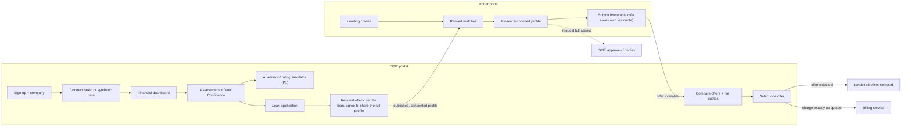

# 02 — How CredSort Works: Use Case, Users, Screens, Business Model

**Date:** 2026-11-19 · **Revision:** 2 · **Status:** Proposed

> The screens below are **derived** from the Master Plan, the Architecture Plan, the diagrams and the OneNote notes. No wireframes exist yet. Treat this as the screen inventory to validate with the team and test users, not as a final UI design. Each screen is mapped to the service(s) that own its data ([03](03-domain-model.md)).

## 1. What CredSort does in one paragraph

A Swiss SME connects its accounting system (bexio first). CredSort turns the ledger into a **standardized, explainable financial profile** with a **preliminary assessment** and a separate **Data Confidence** measure. The SME creates a loan application and decides **exactly which fields** lenders may use. Banks and other lenders define their own criteria, see only consented, published applications, and send **immutable offers**. The SME compares offers on total cost (optionally against an illustrative fair-rate range) and selects one. CredSort never lends and never touches the loan money. It earns fees, and **SMEs will be charged** (amount and trigger to be decided).

*One Profile. Many Lenders. Your Best Rate.*

## 2. Actors

| Actor | Who | Goal |
|---|---|---|
| **SME admin** | Owner / CFO of a Swiss GmbH or AG (more than 2 FTEs), seeking CHF 100k–1M | Get financing with less paperwork at a fair price |
| **SME member** | Accountant or employee invited by the SME admin | Help prepare data and the application (cannot select offers unless authorized) |
| **Lender admin** | Credit head at a cantonal/regional bank, non-bank lender or private debt fund | Configure the organization, officers and lending criteria |
| **Credit officer** | Lender employee | Find suitable applications, review them, submit offers |
| **Fiduciary advisor** *(P2 UI, data model now)* | Treuhänder working for many SMEs | Bring clients onto the platform, help them apply, earn a revenue share |
| **Platform admin** | CredSort team | Verify organizations, manage price books, demo data, operations |
| **External systems** | bexio, LLM provider, KYB vendor (stub first), invoicing provider (pilot), SIX bLink (P2) | Data in, explanations out, verification, invoicing |

## 3. The end-to-end journey

After selection, the lender and the SME complete the loan **directly** (contract, bank-side KYC, disbursement, repayment). CredSort is not in that money flow ([ADR-0014](../adr/0014-no-loan-money-flow.md)).

## 4. SME portal screens

| # | Screen | Purpose | Key content and actions | Service(s) | Priority |
|---|---|---|---|---|---|
| S1 | **Sign-up & company onboarding** | Account and company | Login with MFA (Keycloak); company name, UID (CHE-…), legal form, industry, employees; invite members; KYB status; referral code (fiduciary) | Identity | P0 |
| S2 | **Fees** | What the SME pays, and when | "You pay only if a loan is funded"; expected fee per offer (signed quote); charges with status (payable after 14 days, held, cancelled); amounts **TBD** until decided | Billing | P0 (display) |
| S3 | **Data connection** | Bring accounting data in | Connect bexio (OAuth) or choose a synthetic dataset; import jobs (pending / running / completed / failed), last update, retry | Accounting Integration | P0 |
| S4 | **Financial dashboard** | Understand the financial position | Revenue and growth, EBITDA margin, equity ratio, current ratio, Debt/EBITDA, receivables aging; trends; quality flags; *unavailable* shown as such, never as 0 | Financial Intelligence | P0 |
| S5 | **Assessment** | Preliminary, explainable assessment | Category/score, positive and negative factors, missing information, **Data Confidence** (separate), pipeline versions, disclaimer "not a bank rating" | Financial Intelligence | P0 |
| S6 | **AI advisor & rating simulator** (tab "Simulator") | Explore improvements | Explanation; recommendations; scenario such as "reduce debt by CHF 200,000" with before/after (calculated deterministically, explained by AI) | Advisory + Financial Intelligence (+ Billing entitlement) | P1 |
| S7 | **Loan application wizard** | Describe the financing need | Amount, term, purpose, collateral, additional information; draft | Marketplace | P0 |
| S8 | **Publish & consent** | Decide what lenders may see and use | Field allowlist; recipient scope; **preview "what lenders see"** (the frozen published profile); publish (free) | Marketplace (+ Intelligence for the profile, Billing for the quote) | P0 |
| S9 | **Offers & comparison** | Compare offers | Rate, fees, amount, maturity, repayment schedule, collateral, **total financing cost**, CredSort fee per offer; illustrative fair-rate band (P1); sort by the SME's chosen key | Marketplace (+ Billing quotes) | P0 (band P1) |
| S10 | **Select offer** | Choose exactly one | Confirmation, conflict handling ("offer no longer available", "this offer's quote has expired, ask the lender to resubmit") | Marketplace | P0 |
| S11 | **Access requests** | Control full disclosure | A lender requests full access → approve or deny per lender; revoke (copies already received cannot be recalled) | Marketplace | P0 |
| S12 | **Activity log** | Transparency about data use | Who viewed or used which data and when, across all services | Audit | P0 |
| S13 | **Settings** | Members, roles, connections | Invite or remove members, roles, MFA, disconnect bexio | Identity, Accounting Integration | P0 |
| S14 | **Billing history** | Charges and invoices | Fee charges, invoice status | Billing | P1 |
| S15 | **Notifications & alerts** | Stay informed | Import finished, new offer, refinancing alerts and annual re-rating (Pro tier) | Notification (+ Intelligence, Billing) | P0 basic / P2 alerts |

## 5. Lender portal screens

| # | Screen | Purpose | Key content and actions | Service(s) | Priority |
|---|---|---|---|---|---|
| L1 | **Lender onboarding & officers** | Organization setup | Verified by a platform admin; invite officers; roles; MFA | Identity | P0 |
| L2 | **Lending criteria** | What the lender wants | **Hard eligibility** (industry, amount range, term range, minimum ratios on *allowlistable* metrics) and **preference weights**; versioned | Marketplace | P0 |
| L3 | **Matches** | Find applications | Ranked list of **published, consented** profiles; "why matched" explanation; no counts or sorting on hidden fields | Marketplace | P0 |
| L4 | **Application review** | Look closer | Authorized published profile; "request full access" (goes to S11) | Marketplace | P0 |
| L5 | **Offer composer** | Make an offer | Amount, rate, term, repayment schedule, fees, collateral, validity; total-cost preview; own CredSort fee quote (if a lender fee applies); **immutable once submitted** | Marketplace (+ Billing quote) | P0 |
| L6 | **Pipeline** | Track offers | Submitted / selected / rejected / withdrawn / expired; withdraw own offer | Marketplace | P0 |
| L7 | **Fee statement** | What the lender owes CredSort | Only if a lender success fee is kept | Billing | P1 |
| L8 | **Market insights** | Benchmark | Anonymized aggregates with minimum group size | Marketplace | P2 |

## 6. Fiduciary portal (P2 UI; data model in the MVP)

| # | Screen | Content | Service(s) |
|---|---|---|---|
| F1 | Client portfolio | SMEs that granted delegation; status per client | Identity (+ read models) |
| F2 | Invite client / delegation | The SME admin grants a scoped, revocable delegation | Identity |
| F3 | Portfolio scan | Who is overpaying or due for refinancing | Intelligence + Marketplace |
| F4 | Referrals & commission | Attributed SMEs and the 20 % revenue share | Billing |

## 7. Platform admin (internal)

| # | Screen | Content | Service(s) |
|---|---|---|---|
| A1 | Organization verification | KYB status, lender approval | Identity |
| A2 | Price books | Create, review and schedule activation of price-book versions | Billing |
| A3 | Demo data | Reset and seed synthetic SMEs and lenders; offline/live mode indicator | All (seed jobs) |
| A4 | Operations | Import failures, dead-letter queues, reconciliation mismatches, audit queries | Accounting, platform, Audit |

## 8. Business model as it affects the system (state on 2026-11-23)

**Current (team decision 2026-11-23):** the company discloses its full profile, pays a **one-off CHF 190 per loan request** to unlock lender identities (covers the partner identity check; no refund), and sees offers, rating and fair-rate range before paying. Lenders pay a **success fee** when the payout is confirmed. The table below shows the history of decisions.

| Element | Status | Source |
|---|---|---|
| **SMEs are charged** | **Decided 2026-11-23:** one-off CHF 190 per request to unlock offers ([ADR-0032](../adr/0032-unlock-payment-and-identity-check.md)) | Team |
| SME tiers Basic / Light / Pro | **Not adopted** (team decision 2026-11-19: success-only fee, all features included) | Seb, Business Model canvas |
| SME success fee (payable when the loan is funded) | **Replaced 2026-11-23** by the one-off unlock fee. Lenders keep the success fee with the 14-day dispute window. | Team 2026-11-19 / 2026-11-23 |
| SME success fee (2 % example: CHF 10,000 on CHF 500,000) | Candidate | Gruber §3 |
| Lender success fee 0.75 % (min CHF 2,000, cap CHF 7,500), disclosed to the SME | Earlier working assumption; **to be reconfirmed** | Pitch deck, canvas |
| Fiduciary referral share: 20 % of CredSort's fee | Working assumption | Master Plan, canvas |
| Servicing fee for payment processing and collections | **Not adopted in this form** (it would put CredSort into the money flow). A monitoring/reporting subscription without handling funds is possible. | Gruber §3 → [ADR-0014](../adr/0014-no-loan-money-flow.md) |

**What the architecture guarantees regardless of the final numbers:**

- Every fee rule has a **payer**, a **trigger** and a **calculation**. Changing an amount = activating a new price-book version, not a code change.
- Every fee-bearing action requires a **valid signed quote** shown to the payer beforehand. The charge equals the quote ("honor the quote").
- Fees **never influence matching or ranking** ([ADR-0021](../adr/0021-matching-neutrality.md)).

## 9. Rules the user can see in the UI

1. Connecting bexio **does not** publish anything.
2. Lenders see only published profiles, with the **full profile** the company disclosed, frozen at publication time. Offers are anonymous until the company pays the unlock fee.
3. The assessment is labelled **preliminary and illustrative**; it is not a bank rating or a probability of default.
4. Fair-rate ranges are labelled **illustrative** until empirical data exist.
5. Every lender pays the same disclosed fee; no lender can buy a better position.
6. Live integrations vs simulated data are clearly marked in demos.
