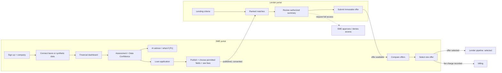

# 02 — How CredSort Works: Use Case, Users, Screens, Business Model

**Date:** 2026-11-19 · **Status:** Proposed

> The screens below are **derived** from the Master Plan, the Architecture Plan, the diagrams and the OneNote notes. No wireframes exist yet. Treat this as the screen inventory to validate with the team and with test users, not as a final UI design.

## 1. What CredSort does in one paragraph

A Swiss SME connects its accounting system (bexio first). CredSort turns the ledger into a **standardized, explainable financial profile** with a **preliminary assessment** and a separate **Data Confidence** measure. The SME creates a loan application and decides **exactly which fields** lenders may use. Banks and other lenders define their own criteria, see only consented, published applications, and send **immutable offers**. The SME compares offers on total cost (optionally against an illustrative fair-rate range) and selects one. CredSort never lends and never touches the loan money. It earns fees, and **SMEs will be charged** (amount and trigger to be decided).

*One Profile. Many Lenders. Your Best Rate.*

## 2. Actors

| Actor | Who | Goal |
|---|---|---|
| **SME admin** | Owner / CFO of a Swiss GmbH or AG (more than 2 FTEs), seeking CHF 100k–1M | Get financing with less paperwork at a fair price |
| **SME member** | Accountant or employee invited by the SME admin | Help prepare data and the application (cannot select offers unless authorized) |
| **Lender admin** | Credit head at a cantonal/regional bank, non-bank lender or private debt fund | Configure the organization, officers and lending criteria |
| **Credit officer** | Lender employee | Find suitable applications, review them, submit offers |
| **Fiduciary advisor** *(P2 UI, data model now)* | Treuhänder working for many SMEs | Bring clients onto the platform, help them apply, earn a revenue share |
| **Platform admin** | CredSort team | Verify lenders, manage price books, demo data, operations |
| **External systems** | bexio (accounting), LLM provider, KYB provider (later), invoicing/payment provider (later), SIX bLink (P2) | Data in, explanations out, verification, billing |

## 3. The end-to-end journey

After selection, the lender and the SME complete the loan **directly** (contract, KYC at the bank, disbursement, repayment). CredSort is not in that money flow ([ADR-0014](../adr/0014-no-loan-money-flow.md)).

## 4. SME portal screens

| # | Screen | Purpose | Key content and actions | Module(s) | Priority |
|---|---|---|---|---|---|
| S1 | **Sign-up & company onboarding** | Create an account and the company | Name, UID (CHE-…), legal form, industry, employees; invite members; KYB status; referral code (fiduciary) | access | P0 |
| S2 | **Plan & fees** | Show what the SME pays, and when | Current plan; fee preview for the next action ("publishing will cost …"); amounts **TBD** until the team decides | billing | P0 (display) |
| S3 | **Data connection** | Bring accounting data in | Connect bexio (OAuth) or choose a synthetic dataset; import jobs (pending / running / completed / failed), last update, retry | accounting | P0 |
| S4 | **Financial dashboard** | Understand the financial position | Revenue and growth, EBITDA margin, equity ratio, current ratio, Debt/EBITDA, receivables aging; trends; quality flags; *unavailable* shown as such, never as 0 | analysis | P0 |
| S5 | **Assessment** | Preliminary, explainable assessment | Category/score, positive and negative factors, missing information, **Data Confidence** (separate), snapshot and scorecard version, disclaimer "not a bank rating" | analysis | P0 |
| S6 | **AI advisor & what-if** | Explore improvements | Plain-language explanation; recommendations; scenario such as "reduce debt by CHF 200,000" with before/after (calculated deterministically, explained by AI) | advisory + analysis | P1 (possibly Pro-tier) |
| S7 | **Loan application wizard** | Describe the financing need | Amount, term, purpose, collateral, additional information; saved as draft | lending | P0 |
| S8 | **Publish & consent** | Decide what lenders may see and use | Field allowlist for matching; recipient scope; **preview "what lenders see"**; fee disclosure; publish | lending + access + billing | P0 |
| S9 | **Offers & comparison** | Compare offers | Side by side: rate, fees, amount, maturity, repayment schedule, collateral, **total financing cost**; illustrative fair-rate band (P1); sort by SME's chosen key | lending | P0 (band P1) |
| S10 | **Select offer** | Choose exactly one | Confirmation, conflict handling ("offer no longer available"), next steps with the lender | lending | P0 |
| S11 | **Access requests** | Control full disclosure | A lender requests full access → approve or deny per lender; revoke later (with the warning that copies already sent cannot be recalled) | access | P0 |
| S12 | **Activity log** | Transparency about data use | Who viewed or used which data and when | access | P0 (simple list) |
| S13 | **Settings** | Members, roles, connections | Invite or remove members, roles, disconnect bexio | access, accounting | P0 |
| S14 | **Billing history** | Charges and invoices | Fee charges, invoice status | billing | P1 |
| S15 | **Alerts** | Ongoing relationship | Refinancing alerts, annual re-rating (Pro tier per canvas) | analysis + billing | P2 |

## 5. Lender portal screens

| # | Screen | Purpose | Key content and actions | Module(s) | Priority |
|---|---|---|---|---|---|
| L1 | **Lender onboarding & officers** | Set up the organization | Verified by a platform admin; invite officers; roles | access | P0 |
| L2 | **Lending criteria** | Define what the lender wants | **Hard eligibility** (industry, amount range, term range, minimum ratios on *permitted* metrics) and **preference weights**; versioned | lending | P0 |
| L3 | **Matches** | Find suitable applications | Ranked list of **published, consented** applications; summary fields only; "why matched" explanation; no counts or sorting on hidden fields | lending + access | P0 |
| L4 | **Application review** | Look closer | Authorized summary; "request full access" (goes to S11) | lending + access | P0 |
| L5 | **Offer composer** | Make an offer | Amount, rate, term, repayment schedule, fees, collateral, validity; total-cost preview; **immutable once submitted** (changes mean a new offer) | lending | P0 |
| L6 | **Pipeline** | Track offers | Submitted / selected / rejected / withdrawn / expired; withdraw own offer | lending | P0 |
| L7 | **Fee statement** | What the lender owes CredSort | Only if a lender success fee is kept in the final model | billing | P1 |
| L8 | **Market insights** | Benchmark | Anonymized aggregates with a minimum group size | lending | P2 |

## 6. Fiduciary portal (P2 UI; data model in the MVP)

| # | Screen | Content |
|---|---|---|
| F1 | Client portfolio | SMEs that granted delegation; status per client |
| F2 | Invite client / delegation | The SME admin grants a scoped, revocable delegation |
| F3 | Portfolio scan | Who is overpaying or due for refinancing (Brainstorming USP) |
| F4 | Referrals & commission | Attributed SMEs and the 20 % revenue share |

## 7. Platform admin (internal, minimal)

| # | Screen | Content |
|---|---|---|
| A1 | Organization verification | KYB status, lender approval |
| A2 | Price books | Create a new version of fee rules and plans; activate from a date ([ADR-0013](../adr/0013-billing-and-sme-charging.md)) |
| A3 | Demo data | Reset and seed the 3 synthetic SMEs and 3 lenders; offline/live mode ([ADR-0024](../adr/0024-deployment-and-demo-modes.md)) |
| A4 | Operations | Import job failures, audit queries |

## 8. Business model as it affects the system (state on 2026-11-19)

| Element | Status | Source |
|---|---|---|
| **SMEs are charged** | **Decided.** Amount and trigger TBD. | Team decision 2026-11-19 |
| SME tiers Basic (free) / Light (one-off fee per financing request) / Pro (annual subscription) | Candidate | Seb, Business Model canvas |
| SME success fee (2 % example: CHF 10,000 on CHF 500,000) | Candidate | Gruber §3 |
| Lender success fee 0.75 % (min CHF 2,000, cap CHF 7,500), disclosed to the SME | Earlier working assumption; **to be reconfirmed** | Pitch deck, canvas |
| Fiduciary referral share: 20 % of CredSort's fee | Working assumption | Master Plan, canvas |
| Servicing fee for payment processing and collections | **Not adopted in this form** (it would put CredSort into the money flow). A monitoring/reporting subscription without handling funds is possible. | Gruber §3 → [ADR-0014](../adr/0014-no-loan-money-flow.md) |

**What the architecture guarantees regardless of the final numbers:**

- Each fee rule has a **payer** (SME, lender), a **trigger** (subscription, application published, offer selected, manual) and a **calculation** (fixed, or percent with min/cap).
- Changing an amount means **activating a new price-book version**, not a code change.
- The fee is **shown before** the action that triggers it.
- Fees **never influence matching or ranking** (neutrality, [ADR-0021](../adr/0021-matching-neutrality.md)).

## 9. Rules the user can see in the UI

1. Connecting bexio **does not** publish anything.
2. Lenders see only published applications and only the fields the SME allowed.
3. The assessment is labelled **preliminary and illustrative**; it is not a bank rating or a probability of default.
4. Fair-rate ranges are labelled **illustrative** until empirical data exist.
5. Every lender pays the same disclosed fee; no lender can buy a better position.
6. Live integrations versus simulated data are clearly marked in demos.
