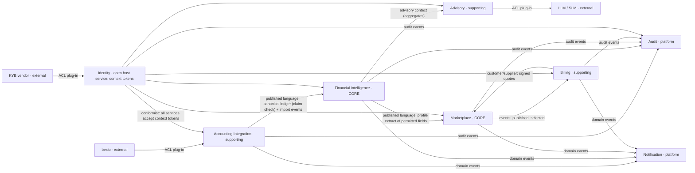

# 03 — Domain and Service Model

**Date:** 2026-11-19 · **Revision:** 2 · **Status:** Proposed · **Decisions:** [ADR-0002](../adr/0002-service-decomposition.md), [ADR-0004](../adr/0004-database-per-service.md), [ADR-0023](../adr/0023-event-driven-integration.md), [ADR-0026](../adr/0026-published-profile-snapshots.md)

## 1. Subdomains

CredSort's business is **reducing information asymmetry and transaction costs in Swiss SME lending**.

| Subdomain | Type | Why | Build / buy | Service |
|---|---|---|---|---|
| **Financial Intelligence**: profiling, ratios, scorecard, Data Confidence, what-if | **Core** | The standardized, explainable profile is what lenders value | Build | Financial Intelligence |
| **Lending Marketplace**: applications, consent, matching, offers, selection, benchmark | **Core** | The two-sided market plus the accumulating offer data ("the moat") | Build | Marketplace |
| **Accounting Integration** | Supporting | Necessary, not differentiating (competitors also connect to bexio) | Build adapters on vendor APIs | Accounting Integration |
| **Commercial**: pricing, quotes, fees, plans, entitlements, referral shares | Supporting | Required now that SMEs pay; rules change often | Build ledger; buy invoicing/payments later | Billing |
| **Advisory**: AI explanations and recommendations | Supporting | Helps adoption; "the moat is the data, not the AI" | Build a thin layer; buy the model | Advisory |
| **Organizations & access**: organizations, memberships, delegation, KYB status | Supporting | Fiduciary delegation and referral attribution are specific to us | Build | Identity |
| **Authentication** (credentials, MFA, sessions) | Generic | Commodity, security-critical | Buy / adopt (Keycloak) | Keycloak |
| **KYB / KYC** | Generic | Commodity; risk can be outsourced | Buy (plug-in, stub first) | via Identity |
| **Notifications** | Generic | In-app first, email later | Build small; buy email delivery | Notification |
| **Audit trail** | Generic, but trust-critical | SMEs must see who used their data | Build small (append-only, hash-chained) | Audit |

## 2. Services (bounded contexts)

Six **domain services** and two **platform services**. Each owns exactly one database ([ADR-0004](../adr/0004-database-per-service.md)).

### 2.1 Identity

| | |
|---|---|
| **Purpose** | Organizations (SME, LENDER, FIDUCIARY, PLATFORM), users (linked to Keycloak subjects), memberships and roles, fiduciary delegation, referral attribution, KYB status; issues **context tokens** |
| **Owns** | Organization, User, Membership, Delegation, ReferralCode, KybCase |
| **External API (via BFF)** | Organization onboarding, members, roles, delegation management, KYB status, `POST /v1/context-tokens` |
| **Internal API** | JWKS for context-token verification; organization lookup (non-sensitive fields) |
| **Publishes** | `identity.organization.created`, `identity.organization.verification_changed`, `identity.organization.suspended`, `identity.membership.revoked`, `identity.delegation.granted`, `identity.delegation.revoked`, `identity.organization.deletion_requested` |
| **Consumes** | — |
| **Plug-ins** | `KybProvider` (stub, vendor) |
| **Must not** | Store financial data; decide consent for applications |

### 2.2 Accounting Integration

| | |
|---|---|
| **Purpose** | Data connections, bexio OAuth tokens (encrypted, only here), import jobs and workers, canonical ledger, pipeline stage 1 (fetch → normalize → validate → batch) |
| **Owns** | DataConnection, ImportJob, ImportBatch, CanonicalAccount, JournalEntry |
| **External API** | Connections (incl. bexio OAuth), import jobs (202 + polling) |
| **Internal API** | `GET /internal/v1/batches/{batch_id}/ledger` (claim check for Intelligence) |
| **Publishes** | `accounting.import.completed`, `accounting.import.failed`, `accounting.connection.revoked` |
| **Consumes** | `identity.organization.deletion_requested` |
| **Plug-ins** | `AccountingDataProvider` (bexio, synthetic; Abacus later; bLink as `BankDataProvider` in P2) |
| **Must not** | Score, rate or rank companies |

### 2.3 Financial Intelligence

| | |
|---|---|
| **Purpose** | Pipeline stage 2: mapping → snapshot → metrics → assessment + Data Confidence; deterministic what-if scenarios; published-profile and advisory-context extracts |
| **Owns** | MappingVersion, FinancialSnapshot, FinancialMetric, ScorecardVersion, CreditAssessment, Scenario |
| **External API** | Current profile, metrics, assessment, scenarios (Pro entitlement) |
| **Internal API** | `GET /internal/v1/assessments/{id}/profile-extract?fields=…` (for Marketplace), `GET /internal/v1/assessments/{id}/advisory-context` (for Advisory) |
| **Publishes** | `intelligence.snapshot.created`, `intelligence.assessment.created`, `intelligence.assessment.failed` |
| **Consumes** | `accounting.import.completed`, `billing.entitlements.changed`, `identity.organization.deletion_requested` |
| **Plug-ins** | Versioned mapping rules, scorecards and industry rule packs (data-driven); `CreditBureauProvider` later |
| **Must not** | Apply lender preferences; read raw bexio payloads; know fees |

### 2.4 Marketplace (transactional core)

| | |
|---|---|
| **Purpose** | Loan applications, **consent (DataDisclosure)**, **published profiles**, lender criteria, eligibility + ranking, offers, selection, rate estimates, benchmark read model, local audit |
| **Owns** | LoanApplication, PublishedProfile, DataDisclosure, LenderPreference, LoanOffer, FeeQuoteRef, RateEstimate, BenchmarkAggregate |
| **External API** | Applications, publication, disclosure and access requests, lender criteria, matches, offers, selection, comparison |
| **Internal API** | — (Marketplace is a consumer of other services' internal APIs) |
| **Publishes** | `marketplace.application.published`, `marketplace.application.matched`, `marketplace.application.withdrawn`, `marketplace.application.closed`, `marketplace.disclosure.granted`, `marketplace.disclosure.revoked`, `marketplace.offer.submitted`, `marketplace.offer.withdrawn`, `marketplace.offer.selected` |
| **Consumes** | `identity.organization.suspended`, `identity.organization.verification_changed`, `identity.membership.revoked`, `identity.organization.deletion_requested` |
| **Plug-ins** | Rate-estimate models (illustrative V1, empirical V2) |
| **Must not** | Recalculate assessments; read raw ledgers; use any billing or fee data in matching/ranking |

### 2.5 Billing

| | |
|---|---|
| **Purpose** | Price books, fee rules, plans, entitlements, **signed quotes**, immutable fee charges, referral shares, invoicing export |
| **Owns** | PriceBook, FeeRule, Plan, Entitlement, Quote, FeeCharge, ReferralShare, Subscription |
| **External API** | Plans, subscriptions, charges, invoices; admin price-book management |
| **Internal API** | `POST /internal/v1/quotes`, `GET /internal/v1/organizations/{id}/entitlements` |
| **Publishes** | `billing.price_book.activated`, `billing.entitlements.changed`, `billing.charge.recorded`, `billing.charge.held` |
| **Consumes** | `marketplace.application.published`, `marketplace.offer.selected`, `identity.organization.created` (referral attribution), `identity.organization.deletion_requested` |
| **Plug-ins** | Fee calculators (fixed, percent with min/cap), `PaymentProvider` (pilot) |
| **Must not** | Influence matching; hold or move loan money |

### 2.6 Advisory

| | |
|---|---|
| **Purpose** | Explanations and recommendations of verified results |
| **Owns** | ExplanationCache (keyed by assessment/scenario version + model version) |
| **External API** | `GET /v1/assessments/{id}/explanation`, `POST /v1/scenarios/{id}/explanation` |
| **Internal API** | — |
| **Publishes / consumes** | `billing.entitlements.changed` (consumes) |
| **Plug-ins** | `LanguageModel` (LLM API, self-hosted SLM, deterministic templates) |
| **Must not** | Access any financial database; calculate or change scores; make lending decisions |

### 2.7 Platform services

| Service | Purpose | Consumes | Data |
|---|---|---|---|
| **Notification** | In-app notifications (email later via channel plug-in); messages contain **no financial values**, only links | Import, assessment, application, offer, charge events | Notification inbox per user |
| **Audit** | Central, append-only, hash-chained audit log; the SME activity view | `*.audit.recorded` from all services | Audit records (actor, action, resource, time, never financial values) |

## 3. Ubiquitous language

| Term | Meaning in CredSort |
|---|---|
| **Organization** | A tenant: SME, LENDER, FIDUCIARY or PLATFORM. All business data belongs to exactly one organization. |
| **Membership** | A user's role in one organization. |
| **Delegation** | A revocable, scoped permission from an SME to a fiduciary organization. |
| **Context token** | A short-lived token issued by Identity stating *user X acts for organization Y with role Z (KYB status, delegations)*. Every service authorizes requests with it. |
| **DataConnection** | A link from an SME to a data source (bexio or synthetic). |
| **ImportJob** | One attempt to fetch data: PENDING → RUNNING → COMPLETED or FAILED. |
| **ImportBatch** | The validated, immutable result of a successful import. |
| **Canonical ledger** | CredSort's provider-independent accounts and journal entries. |
| **Pipeline** | The fixed chain of versioned filters from ImportBatch to assessment. |
| **FinancialSnapshot** | An immutable financial picture for a period, built from one ImportBatch and one MappingVersion. |
| **FinancialMetric** | One value with formula version and quality flags; can be **unavailable** (never 0 by default). |
| **Financial Assessment** | A preliminary, rule-based evaluation of a snapshot; **not** a bank rating or a probability of default. |
| **Data Confidence** | A separate measure of completeness, freshness, consistency, verifiability and provenance. |
| **Scenario** | A what-if recalculation on a copy of a snapshot; never changes the baseline. |
| **LoanApplication** | The SME's financing request: DRAFT → PUBLISHED → OFFER_SELECTED → CLOSED, or WITHDRAWN. |
| **PublishedProfile** | The **frozen copy of the permitted fields** of one assessment, taken at publication; the only financial data lenders ever see in matching. |
| **DataDisclosure** | Consent record: recipient scope, level (summary/full), purpose, permitted fields, revocation time. |
| **LenderPreference** | Versioned lending criteria: eligibility rules plus preference weights. |
| **Match** | An eligible application ranked for one lender, with an explanation. |
| **LoanOffer** | A lender's offer with immutable terms: SUBMITTED → SELECTED, REJECTED, WITHDRAWN or EXPIRED. |
| **Quote** | A **signed**, expiring statement from Billing: "action A by payer P costs X under price-book version V". |
| **FeeCharge** | An immutable ledger entry for a fee owed, created **exactly as quoted**. |
| **PriceBook** | A versioned, dated set of FeeRules and Plans; immutable once active. |
| **Entitlement** | A feature unlocked by a Plan (e.g. what-if analysis in Pro). |
| **ReferralShare** | The share of a fee attributed to the referring fiduciary. |
| **Outbox / Inbox** | Tables that guarantee events are published once a transaction commits (outbox) and processed at most once per consumer (inbox). |
| **AuditRecord** | An immutable record of an action, kept locally and centrally. |

## 4. Context map

Arrows show **upstream → downstream** (data flows downstream).

### Runtime dependency rules

| Rule | Why |
|---|---|
| Synchronous calls only **downstream → upstream** (e.g. Marketplace → Intelligence), never in a cycle | Avoids a distributed monolith |
| At most **two synchronous hops** per user request (BFF → service → one upstream) | Bounds latency and failure propagation |
| No synchronous call **inside** a database transaction | A remote failure must not hold locks or leave half-done work |
| Upstream learns about downstream facts **only through events** | No cycles |
| Every cross-service call carries the user's context token (if on behalf of a user) **and** the caller's service identity | Least privilege at every hop ([ADR-0027](../adr/0027-context-tokens-and-service-trust.md)) |

## 5. Aggregates and invariants

| Aggregate | Service | Invariants (enforced inside one transaction or by DB constraint) |
|---|---|---|
| Membership / Delegation | Identity | One role per user per organization; delegations scoped and revocable; delegation never includes selecting offers or granting disclosure |
| ImportJob | Accounting | Valid state transitions; at most one active job per connection; leased by one worker at a time |
| ImportBatch | Accounting | Immutable; unique per (connection, period, content hash, normalizer version) |
| FinancialSnapshot | Intelligence | Immutable; exactly one ImportBatch and one MappingVersion |
| CreditAssessment | Intelligence | Immutable; references snapshot + ScorecardVersion; reproducible |
| LoanApplication | Marketplace | State machine; publication requires a PublishedProfile, a DataDisclosure, a verified SME and a valid quote if a fee applies; **at most one SELECTED offer** (partial unique index) |
| PublishedProfile | Marketplace | Immutable; contains only permitted fields; references the assessment version it was taken from |
| DataDisclosure | Marketplace | Field allowlist required; revocation final; `full` needs a lender-specific grant |
| LoanOffer | Marketplace | Terms immutable after submission; only its lender may withdraw; only an authorized SME user may select |
| LenderPreference | Marketplace | Versioned; criteria reference only allowlistable fields |
| PriceBook | Billing | Immutable once active; one active version per segment and date |
| Quote | Billing | Signed; expires; bound to (action, subject id, payer, basis); consumed at most once |
| FeeCharge | Billing | Immutable; equals its quote; unique per quote; corrections by reversal |
| AuditRecord | Audit | Append-only; hash chain per stream |

## 6. Data held outside its owner (projections)

Every copy of another service's data is listed here with its staleness bound and rebuild method ([ADR-0011](../adr/0011-consistency-model.md)).

| Copy | Held by | Source of truth | Updated by | Max staleness | Rebuild |
|---|---|---|---|---|---|
| PublishedProfile (permitted fields only) | Marketplace | Intelligence assessment | Synchronous fetch **at publication** (frozen by design) | None: intentionally frozen; "newer assessment available" hint | Re-publication by the SME |
| Organization verification / suspension status | Marketplace | Identity | Context-token claims (≤ 2 min) + events | ≤ token lifetime | Event replay / identity lookup |
| Revoked memberships deny-list | All services | Identity | `identity.membership.revoked` | Event latency (seconds) | Replay |
| Entitlements | Intelligence, Advisory | Billing | `billing.entitlements.changed` + internal API on cache miss | Event latency | Internal API |
| Quote tokens | Marketplace | Billing | Synchronous at display time | Quote lifetime (e.g. 24 h) | Request a new quote |
| Referral attribution | Billing | Identity | `identity.organization.created` | Event latency | Replay |
| Activity log | Audit | Each service's local audit table | `*.audit.recorded` | Event latency | Replay from service outboxes |
