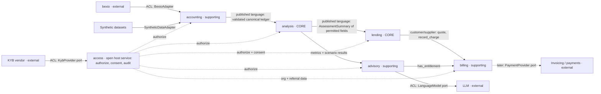

# 03 — Domain Model: Subdomains, Modules, Language, Context Map

**Date:** 2026-11-19 · **Status:** Proposed · **Decisions:** [ADR-0002](../adr/0002-six-domain-modules.md), [ADR-0004](../adr/0004-single-postgresql-and-table-ownership.md), [ADR-0023](../adr/0023-in-process-domain-events.md)

## 1. Subdomains

CredSort's business is **reducing information asymmetry and transaction costs in Swiss SME lending**. The subdomains are classified by how much they differentiate CredSort, which decides where we invest our own engineering.

| Subdomain | Type | Why | Build / buy | Module |
|---|---|---|---|---|
| **Financial Intelligence**: profiling, ratios, scorecard, Data Confidence, what-if | **Core** | The standardized, explainable profile is what lenders value and what SMEs cannot get elsewhere for free. | Build | `analysis` |
| **Lending Marketplace**: applications, consented matching, offers, comparison, rate benchmark | **Core** | The two-sided market plus the accumulating offer data ("the moat, not the AI") | Build | `lending` |
| **Identity, Access & Consent** | Supporting (consent) / Generic (authn) | Consent and field-level disclosure are specific to us; login is not. | Build consent; authn via a maintained library | `access` |
| **Accounting Integration**: adapters, canonical ledger, imports | Supporting | Necessary, but not a differentiator (Systemcredit also connects to bexio). | Build thin adapters on vendor APIs | `accounting` |
| **Advisory**: AI explanations and recommendations | Supporting | Helps adoption, but "the benchmark data and fiduciary channel are what make you different". | Build a thin layer; buy the model | `advisory` |
| **Commercial**: pricing, fees, plans, entitlements, referral commissions | Supporting | Required now that SMEs pay; the rules change often. | Build a simple ledger; buy payment processing later | `billing` |
| **KYB / KYC** | Generic | Verifying companies is a commodity, and the risk can be outsourced (margin note). | Buy (port + stub now) | via `access` |
| **Notifications** | Generic | In-app first, email later | Buy an email provider later | `shared` infrastructure |
| **Payments / invoicing** | Generic | Not in the MVP | Buy later | via `billing` port |

## 2. Modules (bounded contexts)

Six modules in one modular monolith. Each module owns its data, exposes a public `api.py` (facade plus DTOs) and hides everything else.

| Module | Responsibility | Owns (aggregates / tables) | Public API (examples) | Must not |
|---|---|---|---|---|
| `access` | Organizations, users, memberships, roles, authentication, authorization, **consent / DataDisclosure**, delegation, KYB status, audit | Organization, User, Membership, Delegation, DataDisclosure, AuditEvent | `authorize(ctx, action, resource)`, `can_view`, `can_filter(field, application, lender)`, `grant_disclosure`, `record_audit` | Calculate financial values; know fee amounts |
| `accounting` | Data connections, bexio/synthetic adapters, import jobs, canonical ledger | DataConnection, ImportJob, ImportBatch, CanonicalAccount, JournalEntry | `start_import`, `get_job`, `validated_ledger(batch_id)` | Score, rate or rank companies |
| `analysis` | Mapping, snapshots, metrics, scorecard, Data Confidence, deterministic scenarios | FinancialSnapshot, FinancialMetric, CreditAssessment, ScorecardVersion, MappingVersion | `current_profile`, `assess(snapshot)`, `run_scenario`, `assessment_summary(permitted_fields)` | Apply lender preferences; read raw bexio payloads |
| `lending` | Loan applications, publication, lender criteria, eligibility and ranking, offers, comparison, rate benchmark | LoanApplication, LenderPreference, LoanOffer, RateEstimate | `create_application`, `publish`, `matches(lender)`, `submit_offer`, `select_offer` | Recalculate assessments; use fees in ranking |
| `advisory` | Explanations and recommendations via LLM or templates | *(stateless in MVP)* | `explain_assessment`, `explain_scenario` | Calculate or change scores; make lending decisions |
| `billing` | Price books, fee rules, plans, entitlements, fee charges, referral shares | PriceBook, FeeRule, Plan, Entitlement, FeeCharge, ReferralShare | `quote(trigger, context)`, `record_charge(trigger, context)`, `has_entitlement(org, feature)` | Influence matching; hold or move loan money |

`shared` (not a module): Money/Decimal types, DB session and unit of work, error types, event dispatcher, clock, settings. It contains no business rules.

## 3. Ubiquitous language

| Term | Meaning in CredSort |
|---|---|
| **Organization** | A tenant: SME, LENDER, FIDUCIARY or PLATFORM. All data is owned by exactly one organization. |
| **Membership** | A user's role in one organization (SME_ADMIN, SME_MEMBER, LENDER_ADMIN, CREDIT_OFFICER, FIDUCIARY_ADVISOR, PLATFORM_ADMIN). |
| **Delegation** | Revocable, scoped permission from an SME to a fiduciary organization. |
| **DataConnection** | A link from an SME to a data source (bexio or synthetic). |
| **ImportJob** | One attempt to fetch data: PENDING → RUNNING → COMPLETED or FAILED. A retry creates a new job. |
| **ImportBatch** | The validated, immutable result of a successful import (content hash, period). |
| **Canonical ledger** | CredSort's provider-independent accounts and journal entries. |
| **MappingVersion** | A versioned rule set mapping accounts to financial categories. |
| **FinancialSnapshot** | An immutable financial picture for a period, built from one ImportBatch and one MappingVersion. |
| **FinancialMetric** | One value (e.g. equity ratio) with formula version and quality flags; can be **unavailable** (never 0 by default). |
| **Financial Assessment** (CreditAssessment) | A preliminary, rule-based evaluation of a snapshot using a ScorecardVersion. **Not** a bank rating or a probability of default. |
| **Data Confidence** | A separate measure of completeness, freshness, consistency, verifiability and provenance. |
| **Scenario** | A what-if recalculation on a copy of a snapshot; never changes the baseline. |
| **LoanApplication** | The SME's financing request: DRAFT → PUBLISHED → OFFER_SELECTED → CLOSED, or WITHDRAWN. |
| **Publication** | Making an application discoverable, always together with a DataDisclosure. |
| **DataDisclosure** | Consent record: recipient scope, level (summary/full), purpose (matching/review), **permitted fields**, revocation time. |
| **LenderPreference** | Versioned lending criteria: hard **eligibility** rules plus **preference** weights. |
| **Match** | An eligible application ranked for one lender, with an explanation. |
| **LoanOffer** | A lender's offer with immutable terms: SUBMITTED → SELECTED, REJECTED, WITHDRAWN or EXPIRED. |
| **Selection** | The SME choosing exactly one offer; at most one SELECTED offer per application. |
| **RateEstimate** | An **illustrative** rate range with assumptions, sources and version. |
| **PriceBook** | A versioned, dated set of FeeRules and Plans; immutable once active. |
| **FeeRule** | Payer, trigger, calculation (fixed or percent with min/cap), currency, tax code. |
| **FeeCharge** | An immutable ledger entry for a fee owed; corrections are reversal entries. |
| **Entitlement** | A feature unlocked by a Plan (e.g. what-if analysis in Pro). |
| **ReferralShare** | The share of a fee attributed to the fiduciary that referred the SME. |
| **AuditEvent** | An immutable record of a critical action (import, publication, disclosure, access, offer, selection, charge). |

## 4. Context map

Arrows show the direction of **data and dependency** (downstream modules call upstream public APIs).

**Allowed dependencies** (enforced by architecture tests, [ADR-0002](../adr/0002-six-domain-modules.md)):

| Module ↓ may call → | access | accounting | analysis | lending | advisory | billing |
|---|---|---|---|---|---|---|
| access | — | ✗ | ✗ | ✗ | ✗ | ✗ |
| accounting | ✓ | — | ✗ | ✗ | ✗ | ✗ |
| analysis | ✓ | ✓ | — | ✗ | ✗ | ✗ |
| lending | ✓ | ✗ | ✓ | — | ✗ | ✓ (not from matching code) |
| advisory | ✓ | ✗ | ✓ | ✗ | — | ✓ (entitlements only) |
| billing | ✓ | ✗ | ✗ | ✗ | ✗ | — |

There are no cycles. Downstream modules learn about upstream changes by calling upstream APIs. Upstream modules learn about downstream facts only through **domain events** ([ADR-0023](../adr/0023-in-process-domain-events.md)).

## 5. Aggregates and invariants

| Aggregate | Module | Invariants |
|---|---|---|
| ImportJob | accounting | Valid state transitions only; at most one active job per DataConnection; a retry is a new job |
| ImportBatch | accounting | Immutable; unique per (connection, period, content hash, mapping version) |
| FinancialSnapshot | analysis | Immutable; references exactly one ImportBatch and one MappingVersion |
| CreditAssessment | analysis | Immutable; references a snapshot and a ScorecardVersion; reproducible |
| DataDisclosure | access | Field allowlist is required for matching; revocation is final; `full` level needs a lender-specific grant |
| LoanApplication | lending | State machine; publication requires a disclosure and a KYB-verified SME; **at most one SELECTED offer** |
| LoanOffer | lending | Terms immutable after submission; only the owning lender may withdraw; only an authorized SME user may select |
| LenderPreference | lending | Versioned; criteria may reference **only allowlistable fields** |
| PriceBook | billing | Immutable once active; exactly one active version per segment and date |
| FeeCharge | billing | Immutable; amount computed from a specific FeeRule version; corrections by reversal |
| Membership / Delegation | access | One role per user per organization; delegations are scoped and revocable |

## 6. Domain events

Events are published **after commit** for side effects that may be retried or lost without corrupting state (notifications, read models). Writes that must be atomic with the business action (fee charges, audit records) are done **inside the same transaction** through the owner's public API.

| Event | Published by | Consumed by | Effect |
|---|---|---|---|
| `ImportCompleted` | accounting | analysis | Build a snapshot from the validated batch |
| `ImportFailed` | accounting | notifications | In-app message to the SME |
| `SnapshotCreated` | analysis | notifications | "Your profile is updated" |
| `ApplicationPublished` | lending | notifications | Informs matching lenders (in-app) |
| `OfferSubmitted` | lending | notifications | "New offer available" to the SME |
| `OfferSelected` | lending | notifications, benchmark read model | Informs lenders; updates aggregates |
| `DisclosureRevoked` | access | lending | Removes the application from matching results |
| `PlanChanged` | billing | access cache / notifications | Entitlements refresh |
