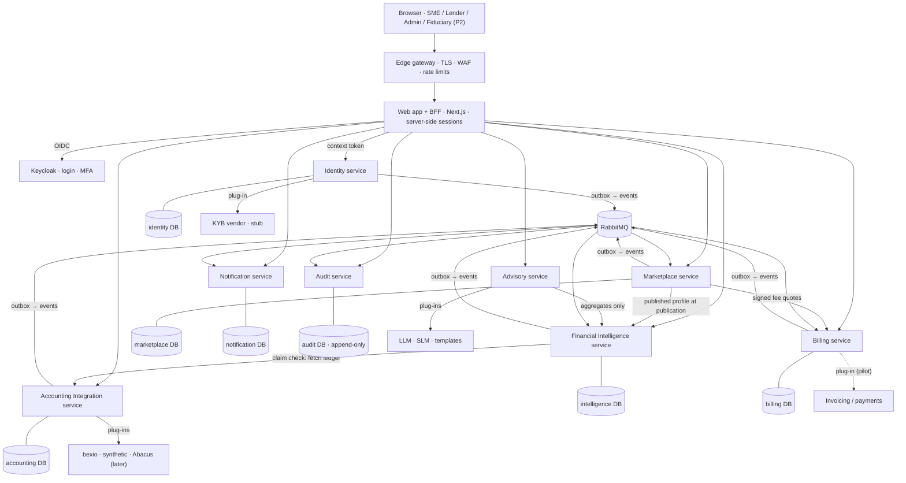

# 05 — Architecture Style Selection and Trade-offs

**Date:** 2026-11-19 · **Revision:** 2 · **Status:** Proposed · **Decision:** [ADR-0001](../adr/0001-architecture-style.md)

> **Revision 2.** Revision 1 chose a modular monolith, mainly because of a feasibility constraint (a two-person team). The stakeholders removed that constraint: implementation capacity is not a limiting factor. The style is therefore selected **purely on architecture characteristics** ([04](04-architecture-characteristics.md), [ADR-0012](../adr/0012-driving-architecture-characteristics.md)).

## 1. Decision in one sentence

> CredSort uses a **service-based architecture** as its backbone: six coarse-grained domain services, each with its own database. Services integrate **event-driven** through a transactional outbox and a message broker. **Microkernel-style plug-ins** sit at every external edge, and a **pipes-and-filters pipeline** turns accounting data into assessments.

## 2. Evaluation criteria

Weights follow the driving characteristics. Feasibility, team size and implementation effort are **not** criteria.

| Characteristic | Weight | Why |
|---|---|---|
| Confidentiality | ×3 | Confidential SME financials; trust is the product |
| Data integrity | ×3 | Assessments and fees must be exact, reproducible and audited |
| Evolvability | ×2 | Pricing, data sources and channels are still changing |
| Fault tolerance | ×1 | bexio, the LLM and other providers fail independently |
| Testability | ×1 | Financial logic must be verifiable in isolation |
| Auditability & explainability | ×1 | Neutral, explainable decisions; full activity history |
| Interoperability | ×1 | More accounting, banking, KYB and invoicing providers over time |

The maximum weighted score is 60. Scores run from 1 (poor) to 5 (excellent) and are the architecture team's judgement for CredSort's context.

## 3. Case for and against every style

### 3.1 Whole-system styles

| Style | For | Against | C | I | E | FT | T | AE | IO | **Score** |
|---|---|---|---|---|---|---|---|---|---|---|
| Layered monolith | One ACID transaction everywhere | Technical partitioning mixes consent, scoring and fees; every module reaches all data; one failure stops everything | 2 | 5 | 1 | 1 | 2 | 3 | 2 | **31** |
| Modular monolith | ACID plus domain boundaries; simple to reason about | All data reachable from every module (boundary enforced only in code); no fault isolation; everything deployed together | 3 | 5 | 3 | 2 | 4 | 4 | 3 | **43** |
| Service-based, shared DB (classic) | Coarse services, still ACID through the shared DB | A shared DB is a shared blast radius and a coupling point; isolation only partial | 3 | 4 | 3 | 3 | 4 | 4 | 3 | **41** |
| **Service-based, DB per service** | Real data isolation and least privilege; fault containment; independent change; transactional flows kept whole inside a service | Cross-service consistency is eventual; needs reliable messaging | 4 | 4 | 4 | 4 | 4 | 4 | 4 | **48** |
| Event-driven (pure) | Loose coupling; best fault tolerance; reacts naturally to "import completed" or "offer submitted" | Eventual consistency everywhere: "exactly one selected offer" and "fee charged with selection" become hard; difficult to audit and reproduce | 3 | 2 | 4 | 5 | 2 | 2 | 4 | **36** |
| Microservices | Highest evolvability; fine-grained deployment and scaling | Splits the consent → matching → offer → selection flow across services (sagas, compensation, double-selection windows); copies financial data into many services; scalability is not a need | 3 | 2 | 5 | 4 | 3 | 2 | 4 | **38** |
| Space-based | Extreme elastic load | In-memory data grids weaken integrity and confidentiality; CredSort has no such load | 2 | 2 | 3 | 4 | 2 | 2 | 3 | **29** |
| Orchestration-driven SOA | Central workflow control | A central orchestrator couples everything; weak evolvability | 3 | 3 | 2 | 2 | 2 | 3 | 4 | **33** |
| Serverless / FaaS | Pay per use; scale to zero | Long imports and strict transactions fit poorly; state scattered; cold starts; hard offline demo | 3 | 2 | 4 | 3 | 2 | 2 | 3 | **33** |

C = confidentiality, I = integrity, E = evolvability, FT = fault tolerance, T = testability, AE = auditability & explainability, IO = interoperability.

### 3.2 Partial styles (cannot carry the whole system, but are excellent in one place)

| Style | For | Against | Where CredSort uses it |
|---|---|---|---|
| **Microkernel (plug-ins)** | Swap providers and rules without touching the core; offline fakes | Not a fit for a multi-domain workflow as a whole | Every external edge: accounting sources, LLMs, KYB, invoicing, notification channels; versioned scorecards, mappings and fee calculators |
| **Pipes & filters (pipeline)** | Each step is pure, versioned, testable and reproducible | Only fits batch-like data flows, not the interactive marketplace | Import → normalize → validate → map → snapshot → metrics → assessment + Data Confidence |

### 3.3 Hybrids

| Hybrid | For | Against | C | I | E | FT | T | AE | IO | **Score** |
|---|---|---|---|---|---|---|---|---|---|---|
| Modular monolith + microkernel + pipeline | Full ACID; excellent testability and explainability | Same isolation and fault-tolerance weaknesses as the monolith | 3 | 5 | 4 | 2 | 5 | 5 | 5 | **49** |
| Microservices + event-driven | Maximum decoupling and resilience | Integrity problems multiplied; data copied everywhere | 3 | 2 | 5 | 5 | 3 | 2 | 4 | **39** |
| **Service-based (DB per service) + event-driven + microkernel + pipeline** ✅ | Every style used only where it is strongest; transactional core kept whole | Most moving parts: broker, several DBs, identity platform | **5** | **4** | **5** | **4** | **4** | **5** | **5** | **55** |

### 3.4 Why the winning hybrid scores where it does

| Characteristic | Score | Reasoning |
|---|---|---|
| Confidentiality | 5 | A database per service with its own credentials; Advisory never touches financial databases; consent lives next to matching (no stale copies); thin events carry IDs, not values; tokens never reach the browser |
| Integrity | 4 (not 5) | Every critical invariant sits inside one service's ACID transaction. Cross-service effects (fees, snapshots) are **eventually** consistent but **guaranteed** by outbox + idempotent inbox + reconciliation. Loses one point against a monolith because effects can lag. |
| Evolvability | 5 | Services change and deploy independently; plug-ins and versioned rule sets turn most business changes into configuration |
| Fault tolerance | 4 | bexio, LLM, billing or notification failures stay contained. Identity remains a critical shared dependency, so not 5. |
| Testability | 4 | Pipeline filters and domain logic are pure; contract tests per service. End-to-end tests need the full stack. |
| Auditability & explainability | 5 | Versioned pipeline outputs, a central tamper-evident audit log, deterministic and explained ranking |
| Interoperability | 5 | Plug-in ports for every external system |

## 4. Why not microservices (the closest "more distributed" alternative)

1. **Integrity:** consent, application state, offers and selection would live in different services. "Exactly one selected offer, audited, with disclosure checked" would become a saga with compensations and race windows. A database constraint can no longer guarantee it.
2. **Confidentiality:** fine-grained services each need copies of financial data. More copies, more endpoints and more service credentials mean a larger attack surface. Consent revocation would propagate with a delay.
3. **Evolvability gain is marginal:** the parts that change independently (pricing, integrations, AI) are already separate services. Consent, matching and offers always change together.
4. **Its main strengths are not our needs:** fine-grained scaling and elasticity are explicitly *not* driving characteristics.

## 5. Architecture quanta

A quantum is an independently deployable unit with high functional cohesion. With a database per service and asynchronous integration, CredSort has **six domain quanta** plus platform components.

| Quantum | Own characteristics | Synchronous dependencies (runtime coupling) |
|---|---|---|
| Identity | Highest availability; security-critical | Keycloak |
| Accounting Integration | Fault tolerance towards bexio; long-running work; holds bexio tokens | — |
| Financial Intelligence | Integrity and reproducibility; CPU-bound pipeline | Accounting (ledger fetch by claim check, asynchronous trigger) |
| Marketplace | Integrity (ACID core), confidentiality (consent + matching) | Intelligence **at publication only**; Billing **for quotes at display time only** |
| Billing | Integrity (immutable ledger), evolvability (pricing) | — |
| Advisory | Cost control, external LLM availability | Intelligence (advisory context) |

Identity is the one dependency every quantum shares at runtime (context tokens, [ADR-0027](../adr/0027-context-tokens-and-service-trust.md)). It is engineered for high availability and short outages are bridged by token lifetimes. Details: [07 — failure modes](07-failure-modes-and-risks.md).

## 6. Architecture overview

## 7. Trade-offs accepted

| We gain | We give up | Mitigation |
|---|---|---|
| Data isolation per service; small blast radius | Cross-service queries are impossible; data must be fetched by API or projected | Thin events + claim-check pulls; documented projections with staleness bounds ([06](06-runtime-and-integration.md)) |
| Independent deployment and change | Contract governance across services | Versioned OpenAPI and event schemas, consumer-driven contract tests ([ADR-0006](../adr/0006-api-contracts.md), [ADR-0023](../adr/0023-event-driven-integration.md)) |
| Fault containment | Eventual consistency for fees, snapshots, notifications, audit | Outbox + idempotent inbox + reconciliation jobs ([ADR-0011](../adr/0011-consistency-model.md)) |
| Strong security posture (IdP, MFA, BFF, mTLS in pilot) | More infrastructure: Keycloak, broker, gateway, several DBs | Everything runs in Docker Compose locally, including offline demos ([ADR-0024](../adr/0024-deployment.md)) |
| Explainable, reproducible assessments | Pipeline versions must be managed | Version registry in Intelligence ([ADR-0025](../adr/0025-financial-data-pipeline.md)) |
| Distributed tracing of complex flows | Debugging spans several processes | OpenTelemetry across HTTP and messages ([ADR-0029](../adr/0029-observability.md)) |
| Higher operational cost | Not a driving concern by stakeholder decision | — |

## 8. Revisit when

- A service becomes a hotspot that needs finer decomposition (consider splitting *that* service only).
- Identity outages measurably affect availability (consider token-lifetime tuning or regional replicas).
- Event volume or replay needs outgrow RabbitMQ (consider a log-based broker).
- Regulators require stronger isolation of a component (e.g. billing with payments) → a separate security zone.
