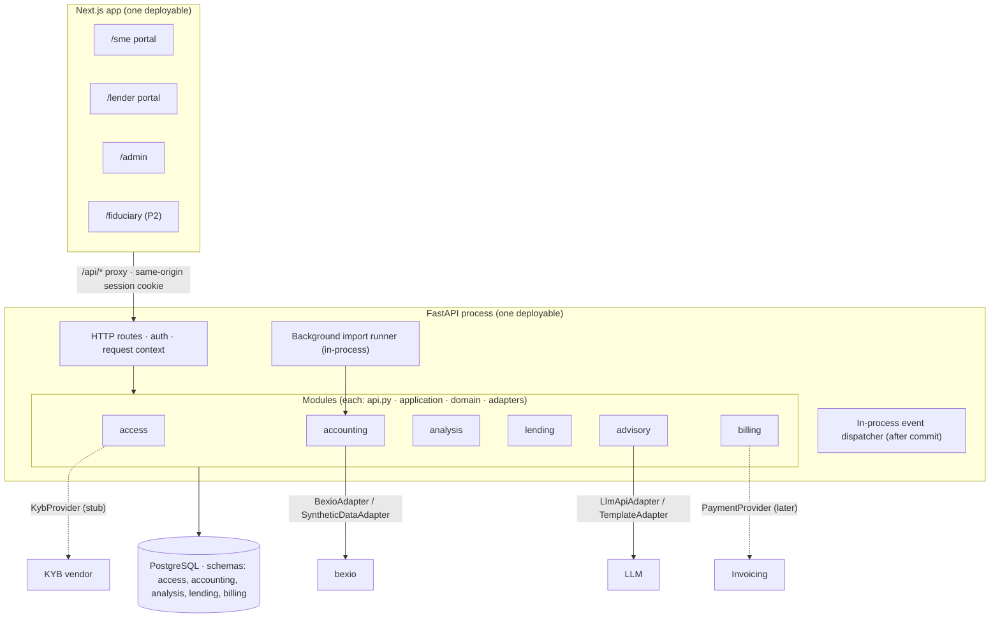

# 05 — Architecture Style and Trade-offs

**Date:** 2026-11-19 · **Status:** Proposed · **Decision:** [ADR-0001](../adr/0001-modular-monolith.md)

## 1. Partitioning: by domain, not by technical layer

| Option | Top-level split | Fit for CredSort |
|---|---|---|
| Technical partitioning | `controllers/`, `services/`, `repositories/` for everything | A change to "how SMEs are charged" would touch every layer. Boundaries between consent, scoring and fees would blur. |
| **Domain partitioning** ✅ | `access/`, `accounting/`, `analysis/`, `lending/`, `advisory/`, `billing/` | Changes follow business capabilities. Ownership and tests per module. Modules can be extracted later. |

Inside each module we use a small hexagonal layout: `domain/` (pure rules), `application/` (use cases, transactions), `adapters/` (HTTP routes, persistence, external systems), `api.py` (the only thing other modules may import).

## 2. Architecture quanta

A **quantum** is an independently deployable part with its own characteristics and synchronous coupling. We check whether any part of CredSort needs characteristics so different from the rest that it deserves its own quantum.

| Part | Distinct needs? | Own quantum now? |
|---|---|---|
| SME and lender use cases (profile, application, matching, offers) | Confidentiality + integrity, synchronous, transactional | Core quantum |
| Billing (fee charges) | Same integrity needs; must commit atomically with offer selection | Core quantum. Separating it would require distributed transactions. |
| Accounting import | Long-running, depends on an external API, needs fault tolerance | **No.** In-process background job with recovery ([ADR-0005](../adr/0005-sync-use-cases-and-background-import.md), [ADR-0010](../adr/0010-import-recovery-and-idempotency.md)). First candidate to move into a separate *worker process* of the same codebase. |
| Advisory (LLM) | External availability, cost, latency | **No.** Template fallback isolates failures. Candidate for extraction if AI usage grows. |
| Benchmark analytics | Read-heavy aggregates | **No.** Materialized views in `lending` until volume justifies a warehouse. |

**Result: one quantum.** Two documented future split candidates (import worker, advisory).

## 3. Candidate styles and scoring

Scores are **our assessment for CredSort's context** (team of two, MVP, confidential financial data), from 1 (poor) to 5 (excellent). Weights reflect the driving characteristics ([04](04-architecture-characteristics.md)), with feasibility weighted as heavily as the top two because it is a hard constraint.

| Style | Confidentiality ×3 | Integrity ×3 | Evolvability ×2 | Feasibility ×3 | Testability ×1 | Fault tolerance ×1 | **Weighted (max 65)** |
|---|---|---|---|---|---|---|---|
| Layered monolith | 3 | 4 | 2 | 5 | 2 | 2 | 44 |
| **Modular monolith** | **4** | **5** | **4** | **5** | **4** | **2** | **56** |
| Microkernel (plug-in) | 3 | 4 | 4 | 4 | 3 | 2 | 46 |
| Service-based | 3 | 4 | 4 | 3 | 4 | 3 | 45 |
| Event-driven | 2 | 2 | 4 | 2 | 2 | 4 | 32 |
| Microservices | 2 | 2 | 5 | 1 | 4 | 4 | 33 |
| Space-based | 2 | 2 | 3 | 1 | 1 | 3 | 25 |

### Why each alternative loses

- **Layered monolith.** As simple to run, but technical partitioning lets consent, scoring and billing logic leak into each other. Evolvability is low because every business change crosses all layers.
- **Microkernel.** Good for pluggable *providers* (accounting sources, LLMs, KYB, pricing policies), and we adopt that idea at the edges. CredSort's core is a multi-step workflow across several domains, not a single core with plug-ins.
- **Service-based** (a few coarse services, often with a shared DB). The most credible *next* step. Today it would add network calls, service authentication and deployment work without a measured benefit.
- **Event-driven.** Eventual consistency conflicts with "exactly one selected offer" and "fee charged with the selection". Debugging and demo reproducibility suffer.
- **Microservices.** Each service needs its own database, so offer selection, fee recording and audit would need sagas. Each service is an extra attack surface. Two developers cannot operate it.
- **Space-based.** Built for extreme, elastic load that CredSort does not have.

## 4. Chosen style

> **A domain-partitioned modular monolith with ports & adapters at the external edges**: one FastAPI backend with six modules, one PostgreSQL database with a schema per module, and one Next.js frontend. Deployed with Docker Compose as a single architecture quantum.



### How the style delivers each driving characteristic

| Characteristic | Mechanism |
|---|---|
| Confidentiality | One security perimeter; authorization and consent centralized in `access` and enforced in every application service; tenant-scoped repositories; RLS before the pilot ([ADR-0008](../adr/0008-consent-and-permitted-field-matching.md), [ADR-0016](../adr/0016-authentication.md), [ADR-0017](../adr/0017-tenant-isolation.md)) |
| Data integrity | Local ACID transactions; DB constraints; immutable versioned snapshots, assessments, offers and fee charges; Decimal money ([ADR-0011](../adr/0011-transaction-boundaries-and-offer-concurrency.md), [ADR-0015](../adr/0015-money-and-financial-calculations.md)) |
| Evolvability | Module boundaries enforced by tests; ports for unstable providers; price books, scorecards and mappings as versioned data ([ADR-0002](../adr/0002-six-domain-modules.md), [ADR-0003](../adr/0003-ports-and-adapters.md), [ADR-0013](../adr/0013-billing-and-sme-charging.md)) |
| Feasibility | One repository, one backend, one DB, one `docker compose up`; no broker, cache or orchestrator |

## 5. Trade-offs we accept

| We gain | We give up | Mitigation |
|---|---|---|
| ACID across modules (selection + fee + audit in one transaction) | Modules cannot be deployed or scaled independently | Clear extraction path; revisit triggers below |
| One process: simple operations, fast local calls | A crash or memory leak affects the whole app | Health checks, restart policy, import recovery rule |
| One shared database | Risk of modules coupling through tables | Schema per module, single table ownership, **no cross-schema foreign keys**, architecture tests ([ADR-0004](../adr/0004-single-postgresql-and-table-ownership.md)) |
| Boundaries in code (cheap) | Boundaries erode if nobody checks | import-linter contracts in CI; PR review of cross-module changes |
| In-process background jobs | Jobs are lost on restart | Mark interrupted jobs FAILED; safe manual retry ([ADR-0010](../adr/0010-import-recovery-and-idempotency.md)) |
| In-process events (no broker) | No delivery guarantee for after-commit handlers | Only best-effort side effects use events; critical writes stay in the transaction ([ADR-0023](../adr/0023-in-process-domain-events.md)) |
| Built-in auth that works offline | Must be hardened before real users | OIDC + MFA before pilot ([ADR-0016](../adr/0016-authentication.md)) |
| Rule-based scorecard (explainable) | Less predictive than a statistical model | Labelled illustrative; ML only with real outcome data |

## 6. Evolution path

| Stage | Architecture | Trigger to move on |
|---|---|---|
| **1 · MVP / demo** | Modular monolith, one process, Docker Compose, built-in auth, offline mode | Pilot with real SMEs and lenders agreed |
| **2 · Pilot** | Same codebase plus a separate **worker process** for imports; PostgreSQL RLS; OIDC + MFA; Swiss/EU managed hosting; real KYB vendor; invoicing provider | Measured load, availability needs, or team growth |
| **3 · Commercial** | Service-based split only where measured: e.g. *accounting integration* and *advisory* as services; benchmark warehouse | Independent release cadence, scale, or regulatory isolation |

**Revisit the modular monolith when** any of these hold: sustained import load blocks interactive requests; AI must scale or fail independently; production bank APIs require separate security zones; more than about 6 developers work in parallel; or a regulator requires a component (e.g. payments) to be isolated.

## 7. Target repository structure

```text
credsort/
  frontend/                       # Next.js (App Router, TypeScript)
    app/(sme)/  app/(lender)/  app/(admin)/  app/(fiduciary)/   # route groups = portals
    lib/api/                      # client generated from docs/api/openapi.json
  backend/
    credsort/
      main.py                     # composition root, DI, route registration
      shared/                     # Money, UnitOfWork, errors, events, clock, settings
      access/      accounting/   analysis/   lending/   advisory/   billing/
        api.py                    # public facade + DTOs (only cross-module import)
        domain/                   # pure rules, no FastAPI/SQLAlchemy imports
        application/              # use cases, transaction boundaries
        adapters/                 # http routes, repositories, external adapters
        ports/                    # only where an external dependency needs one
    migrations/                   # Alembic; each migration touches one schema
    tests/  unit/  integration/  e2e/  architecture/
  demo_data/                      # 3 synthetic SMEs, 3 lenders (no real clients)
  docs/  architecture/  adr/  api/  financial-methodology.md  bexio-feasibility.md
  docker-compose.yml
```

### Architecture fitness functions (sketch; verify exact syntax when CI is set up)

```ini
# backend/.importlinter
[importlinter]
root_package = credsort
include_external_packages = True

[importlinter:contract:module-layers]
name = Module dependency direction
type = layers
layers =
    credsort.lending | credsort.advisory
    credsort.analysis | credsort.billing
    credsort.accounting
    credsort.access
    credsort.shared

[importlinter:contract:neutrality]
name = Matching never sees billing
type = forbidden
source_modules = credsort.lending.domain.matching
forbidden_modules = credsort.billing

[importlinter:contract:pure-domain]
name = Domain code is framework-free
type = forbidden
source_modules =
    credsort.access.domain
    credsort.accounting.domain
    credsort.analysis.domain
    credsort.lending.domain
    credsort.billing.domain
forbidden_modules = fastapi
    sqlalchemy
```

Additional rules to check in tests or review: cross-module imports go only through `<module>.api`; `billing` must not import `accounting` or `analysis`.
