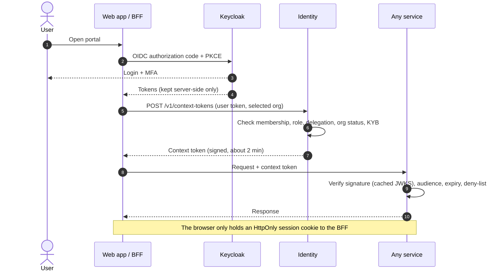
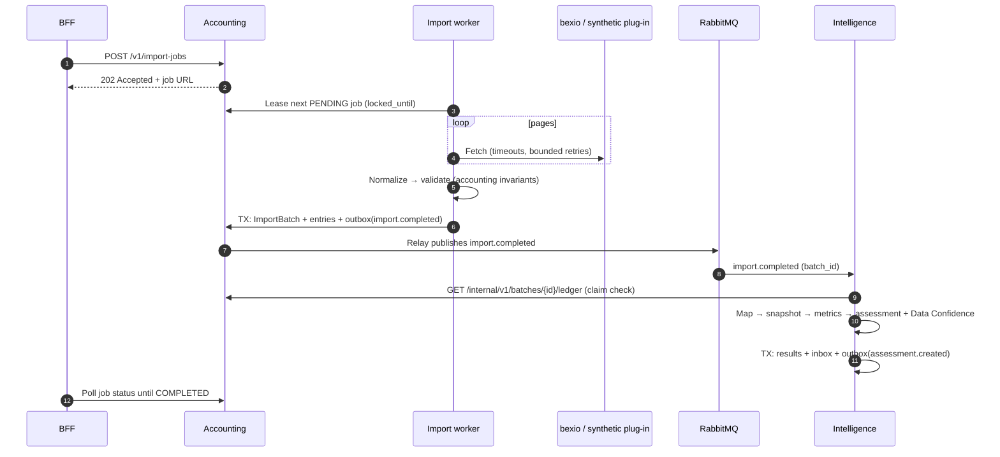
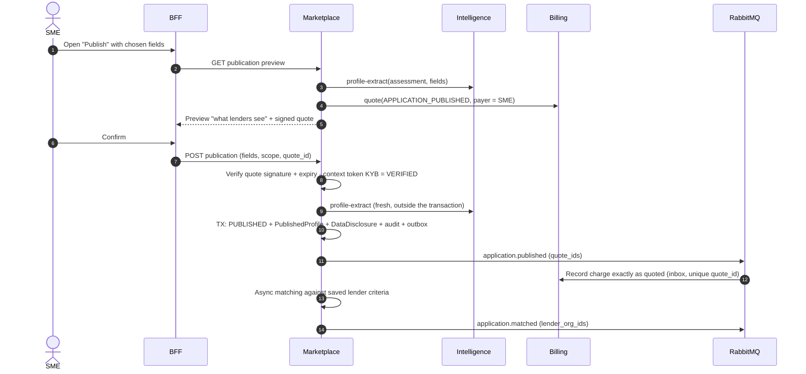
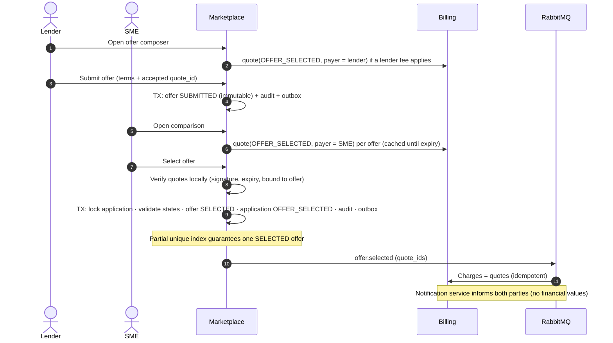

# 06 — Runtime and Integration View

**Date:** 2026-11-19 · **Status:** Proposed · **Decisions:** [ADR-0006](../adr/0006-api-contracts.md), [ADR-0007](../adr/0007-resilience.md), [ADR-0011](../adr/0011-consistency-model.md), [ADR-0023](../adr/0023-event-driven-integration.md), [ADR-0027](../adr/0027-context-tokens-and-service-trust.md)

## 1. Communication styles

| Style | Used for | Technology | Guarantees |
|---|---|---|---|
| **User request** | Browser → BFF → one service | HTTPS (edge), HTTP/JSON (internal network; mTLS in the pilot) | Synchronous; context token per call |
| **Internal query** | Service → upstream service, *only* where a fresh answer is required | HTTP/JSON `/internal/v1/*` | Timeout, retry (idempotent GET only), circuit breaker |
| **Domain event** | Every fact other services react to | RabbitMQ topic exchange `credsort.events`, quorum queues, publisher confirms | At-least-once via transactional outbox; exactly-once *effect* via consumer inbox |
| **Claim check** | Large or sensitive payloads (ledgers) | Event carries an ID → consumer fetches through an authorized internal API | Data stays in its owner; access is authorized and audited |

## 2. Synchronous call inventory (complete)

No other service-to-service calls are allowed (fitness function FF-E6).

| # | Caller → callee | Endpoint | On behalf of | Purpose | Timeout | On failure |
|---|---|---|---|---|---|---|
| C1 | BFF → Identity | `POST /v1/context-tokens` | User | Exchange the Keycloak session for a context token | 2 s | Login/requests fail; cached token reused until expiry |
| C2 | Any service → Identity | `GET /.well-known/jwks.json` | Service | Verify context tokens | 2 s | Use cached keys (rotation overlap ≥ 24 h) |
| C3 | Intelligence → Accounting | `GET /internal/v1/batches/{id}/ledger` | Service (event-driven job) | Claim check for the pipeline | 30 s | Message retried with backoff; then DLQ + alert |
| C4 | Marketplace → Intelligence | `GET /internal/v1/assessments/{id}/profile-extract` | User (SME) | Publication preview and frozen PublishedProfile | 3 s | Publication blocked: "profile service unavailable, try again" |
| C5 | Marketplace → Billing | `POST /internal/v1/quotes` | User (SME or lender) | Signed fee quotes when showing a fee-bearing action | 2 s | Show "fee unavailable"; action blocked if no valid cached quote (**fail closed**) |
| C6 | Advisory → Intelligence | `GET /internal/v1/assessments/{id}/advisory-context` | User (SME) | Aggregates for explanations | 3 s | Explanation unavailable message |
| C7 | Intelligence, Advisory → Billing | `GET /internal/v1/organizations/{id}/entitlements` | Service | Cache miss only (normally event-fed) | 2 s | Deny the gated feature (fail closed) |

All internal calls are **outside** database transactions and at most **one hop** behind the BFF.

## 3. Events

### 3.1 Envelope (CloudEvents 1.0, JSON)

| Attribute | Example | Notes |
|---|---|---|
| `id` | UUID | Idempotency key for consumers |
| `type` | `credsort.marketplace.offer.selected.v1` | `credsort.<service>.<aggregate>.<event>.v<major>` |
| `source` | `/services/marketplace` | Producer |
| `subject` | `offer/6f1…` | Aggregate reference |
| `time` | RFC 3339 | Producer commit time |
| `credsortorgid` | UUID | Owning organization (routing, deletion, RLS on consumer side) |
| `credsortaggregateversion` | integer | Monotonic per aggregate; consumers drop stale versions |
| `traceparent` | W3C | Distributed tracing |
| `data` | `{…}` | **Thin**: IDs, states, versions. Never ledger data, metrics, profile values or personal data. |

### 3.2 Catalogue

| Event | Producer | Consumers | `data` (thin) |
|---|---|---|---|
| `identity.organization.created.v1` | Identity | Billing | org_id, org_type, referred_by_org_id? |
| `identity.organization.verification_changed.v1` | Identity | Marketplace, Notification | org_id, kyb_status |
| `identity.organization.suspended.v1` | Identity | all services | org_id |
| `identity.membership.revoked.v1` | Identity | all services | org_id, user_id, revoked_at |
| `identity.delegation.granted.v1` / `.revoked.v1` | Identity | Notification, Audit | sme_org_id, fiduciary_org_id, scopes |
| `identity.organization.deletion_requested.v1` | Identity | all data-holding services | org_id, requested_at |
| `accounting.import.completed.v1` | Accounting | Intelligence, Notification | org_id, batch_id, period, content_hash |
| `accounting.import.failed.v1` | Accounting | Notification | org_id, job_id, reason_code |
| `accounting.connection.revoked.v1` | Accounting | Notification | org_id, connection_id |
| `intelligence.snapshot.created.v1` | Intelligence | Notification | org_id, snapshot_id, batch_id |
| `intelligence.assessment.created.v1` | Intelligence | Notification | org_id, assessment_id, snapshot_id, versions |
| `intelligence.assessment.failed.v1` | Intelligence | Notification | org_id, batch_id, reason_code |
| `marketplace.application.published.v1` | Marketplace | Billing, Notification | application_id, sme_org_id, quote_ids[] |
| `marketplace.application.matched.v1` | Marketplace | Notification | application_id, lender_org_ids[] |
| `marketplace.application.withdrawn.v1` / `.closed.v1` | Marketplace | Notification | application_id |
| `marketplace.disclosure.granted.v1` / `.revoked.v1` | Marketplace | Notification | application_id, lender_org_id?, level |
| `marketplace.offer.submitted.v1` | Marketplace | Notification | offer_id, application_id, lender_org_id |
| `marketplace.offer.withdrawn.v1` | Marketplace | Notification | offer_id |
| `marketplace.offer.selected.v1` | Marketplace | Billing, Notification | offer_id, application_id, sme_org_id, lender_org_id, quote_ids[] |
| `billing.price_book.activated.v1` | Billing | Notification (admins) | price_book_version, effective_from |
| `billing.entitlements.changed.v1` | Billing | Intelligence, Advisory | org_id, entitlements[] |
| `billing.charge.recorded.v1` / `.held.v1` | Billing | Notification, Audit | charge_id, org_id, quote_id |
| `<service>.audit.recorded.v1` | every service | Audit | actor, acting_org, on_behalf_of_org, action, resource ref, time |

### 3.3 Delivery rules

1. **Transactional outbox:** the event row is written in the same DB transaction as the state change. A relay publishes it with publisher confirms and marks it sent.
2. **Idempotent inbox:** each consumer stores `event_id` in its inbox table in the same transaction as its side effect (unique constraint).
3. **Retries and DLQ:** delayed retries with backoff (e.g. 5 attempts), then the dead-letter queue + alert. A replay tool re-publishes from outbox tables (retained ≥ 35 days).
4. **Ordering:** not guaranteed across queues. Consumers compare `credsortaggregateversion` and ignore stale events.
5. **Schema evolution:** additive changes only within a major version; breaking changes publish `v2` alongside `v1` until all consumers migrate.

## 4. Key flows

### 4.1 Login and context token

### 4.2 Import → assessment (pipeline)

### 4.3 Publish an application

### 4.4 Offer, selection and charge

### 4.5 Revocation (consent and membership)

| Trigger | Where enforced | Delay |
|---|---|---|
| SME revokes a disclosure | Marketplace, same transaction that serves matching → **immediate** | None |
| Admin removes a member | Identity stops issuing context tokens immediately; services add the user to their deny-list on `membership.revoked` | Event latency (seconds); worst case token lifetime (about 2 min) |
| Organization suspended | Same mechanism (`organization.suspended`) | Same |

### 4.6 What-if with AI explanation

1. SME → BFF → Intelligence `POST /v1/scenarios` (entitlement checked from the event-fed cache) → deterministic recalculation on a snapshot copy.
2. BFF → Advisory `POST /v1/scenarios/{id}/explanation` → Advisory calls Intelligence `advisory-context` (aggregates only) → `LanguageModel` plug-in → on timeout or failure, the template plug-in.
3. The response is labelled "AI-generated explanation" with the scenario and model versions.

### 4.7 Organization deletion (data lifecycle)

`identity.organization.deletion_requested` → every data-holding service deletes or anonymizes its data per [ADR-0031](../adr/0031-data-lifecycle-and-deletion.md) and publishes an audit record → Identity tracks completion per service and closes the request only when all services have confirmed.

## 5. Consistency model

| Flow | Consistency | Mechanism | Expected lag | Reconciliation |
|---|---|---|---|---|
| Publication + disclosure + profile + audit | **Strong** (one Marketplace transaction) | ACID | — | — |
| Offer selection (one selected, states, audit) | **Strong** | Row lock + partial unique index | — | — |
| Consent revocation vs matching | **Strong** | Same database | — | — |
| Fee charge after publication or selection | Eventual, **guaranteed** | Outbox → inbox, unique per quote | Seconds | Daily: every `offer.selected` / `application.published` with quotes has charges |
| Snapshot/assessment after import | Eventual, guaranteed | Outbox → inbox → claim check | Seconds to minutes | Daily: every batch has a snapshot or a failure record |
| Central activity log | Eventual, guaranteed | Outbox → Audit | Seconds | Daily: local vs central counts per service; hash-chain verification |
| Notifications | Eventual, best effort with retries | Outbox → inbox | Seconds | — |
| Membership or organization suspension | Bounded | Token lifetime + deny-list | ≤ about 2 min | — |
| Entitlements | Eventual | Event-fed cache; API on miss | Seconds | Cache rebuild on startup |

## 6. Idempotency summary

| Interaction | Idempotency mechanism |
|---|---|
| External mutations (publish, submit offer, select, start import) | `Idempotency-Key` header stored per (org, key) for 24 h |
| Event consumption | Inbox table: unique `(consumer, event_id)` |
| Fee charges | Unique `quote_id` per charge |
| Import batches | Unique `(connection, period, content_hash, normalizer_version)` |
| Snapshots | Unique `(batch_id, mapping_version)` |
