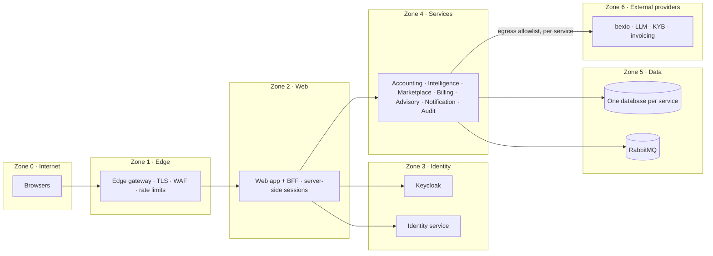

# 08 — Security and Data Protection

**Date:** 2026-11-19 · **Status:** Proposed · **Decisions:** [ADR-0008](../adr/0008-consent-and-permitted-field-matching.md), [ADR-0016](../adr/0016-authentication.md), [ADR-0017](../adr/0017-tenant-isolation.md), [ADR-0027](../adr/0027-context-tokens-and-service-trust.md), [ADR-0028](../adr/0028-central-audit-log.md), [ADR-0031](../adr/0031-data-lifecycle-and-deletion.md)

Confidentiality is CredSort's first driving characteristic. This view shows where data lives, who can reach it, and which controls apply at every boundary.

## 1. Trust zones

| Boundary | Controls |
|---|---|
| Internet → Edge | TLS 1.2+, HSTS, WAF rules, rate limits per IP and per session, request size limits |
| Edge → Web | Only the BFF is routable; `/internal/*` paths and services are **not** exposed |
| Web → Services | Context token on every call; services re-verify (zero trust); mTLS in the pilot |
| Service → Service | Service identity token (client credentials, audience-restricted) **and** the user's context token when acting on a user's behalf; allowed-caller matrix ([ADR-0027](../adr/0027-context-tokens-and-service-trust.md)) |
| Service → Data | Each service has credentials **only** for its own database and its own broker queues; RLS on tenant tables |
| Service → External | Per-service egress allowlist (e.g. only Accounting may reach bexio; only Advisory the LLM) |

## 2. Data classification

| Class | Meaning | Examples | Handling rules |
|---|---|---|---|
| **C4 Strictly confidential** | Disclosure causes severe harm | Journal entries, full snapshots and metrics, bexio OAuth tokens, credentials and MFA secrets | Own service only; encrypted at rest; field-level encryption for tokens; never in events, logs, traces, notifications or LLM prompts |
| **C3 Confidential** | Business-sensitive or personal | Assessments, published profiles, applications, offers, disclosures, fee charges, user names and emails, audit records | Own service only; shared only through authorized APIs or frozen copies under consent; never in logs |
| **C2 Internal** | Not for the public | Price books, anonymized benchmark aggregates (k ≥ 5), operational metrics | Authenticated access |
| **C1 Public** | Can be published | Marketing content, published methodology summaries | — |

## 3. Data inventory per service

| Service | C4 | C3 | Notes |
|---|---|---|---|
| Identity | — (credentials stay in Keycloak) | Users, organizations, memberships, delegations, KYB evidence references | KYB documents stay with the vendor; Identity keeps references |
| Keycloak | Credentials, MFA secrets | User profile | Separate database |
| Web app (BFF) | Users' OIDC access/refresh tokens (session store) | — | Small dedicated session database; tokens encrypted at rest; never sent to the browser |
| Accounting | Ledger, bexio tokens | Connections, import jobs | Tokens envelope-encrypted with a KMS key |
| Intelligence | Snapshots, metrics | Assessments, scenarios | Largest store of financial data |
| Marketplace | — | Published profiles (permitted fields only), applications, disclosures, offers | Holds **no** ledger data and **no** non-permitted metrics |
| Billing | — | Quotes, charges (incl. loan principal as fee basis), plans | Principal is the minimum needed for percentage fees |
| Advisory | — | Explanation cache (text derived from aggregates) | **No database access to financial services** |
| Notification | — | Notification texts without values, recipient IDs | — |
| Audit | — | Actor, action, resource IDs, time | No financial values |

## 4. Authentication

- **Users:** Keycloak with OIDC (authorization code + PKCE). **MFA required** for all lender users and SME admins; optional for other SME members until the pilot, then required ([ADR-0016](../adr/0016-authentication.md)).
- **Browser:** holds only an `HttpOnly`, `Secure`, `SameSite=Lax` session cookie for the BFF. Access and refresh tokens never reach the browser.
- **Services:** accept only **Identity-issued context tokens** for user calls and **Keycloak client-credentials tokens** for service identity.

## 5. Authorization layers

Every request passes all applicable layers. A failure at any layer denies the request.

| Layer | Where | Question answered |
|---|---|---|
| 1. Authentication | BFF + every service (token verification) | Who is calling, and is the token valid, unexpired and not deny-listed? |
| 2. Organization scope | Every service (context token `org_id`) + RLS | Does the resource belong to the caller's organization, or is there a delegation? |
| 3. Role / permission | Every service (context token `role`, `scopes`) | May this role perform this action (e.g. only SME_ADMIN selects offers)? |
| 4. Consent | Marketplace only | Is the application published, and is this field or level disclosed to this lender? |
| 5. Entitlement | Intelligence, Advisory | Does the organization's plan include this feature? |
| 6. Service allow-list | Callee of internal APIs | Is the calling service allowed to call this endpoint? |

## 6. Encryption and secrets

| Item | Control |
|---|---|
| In transit | TLS at the edge; mTLS between services and to databases and the broker in the pilot |
| At rest | Encrypted volumes and encrypted backups for every database and the broker |
| Field level | bexio OAuth tokens (envelope encryption, KMS-held key, rotation) |
| Context-token signing keys | Identity key pair in the secret manager; rotation with JWKS overlap ≥ 24 h |
| Secrets | `.env` locally (never committed); secret manager in the pilot; per-service secrets, no shared credentials |

## 7. Logging, tracing and events

- Allowlist-based structured logging: only IDs, states, versions, durations and error codes.
- OpenTelemetry attributes follow the same allowlist; request and response bodies are never recorded.
- Event payloads are thin (IDs and states) and are checked against the confidential-field catalogue in CI (FF-C5).
- Notifications contain links, never values ("A new offer is available").

## 8. Threat model (summary)

| Threat | Example | Primary controls |
|---|---|---|
| **Spoofing** | Stolen session or token used by an attacker | MFA; tokens server-side in the BFF; context tokens of about 2 minutes; audience restriction |
| **Tampering** | Altered fee or offer terms | Immutable offers and charges; signed quotes; hash-chained audit log |
| **Repudiation** | "I never selected that offer" | Audit records with actor, organization, time and request ID; central tamper-evident log |
| **Information disclosure** | Cross-tenant read; inference through lender filters; leakage via logs or events | RLS + probe tests; permitted-field matching; thin events; log scrubbing; DB per service |
| **Denial of service** | Import floods; abusive search | Rate limits at the edge; worker isolation; per-organization quotas on imports and matching |
| **Elevation of privilege** | Fiduciary acting beyond its delegation; compromised Advisory | Delegation scopes in context tokens; least-privilege service credentials; network policies |

## 9. Data protection (Swiss nFADP)

| Principle | How the architecture supports it |
|---|---|
| Purpose limitation | Each service stores data only for its purpose; the Marketplace stores only permitted fields |
| Data minimization | Thin events; frozen PublishedProfiles; Advisory gets aggregates only |
| Transparency | Activity log (Audit) visible to the SME; "what lenders see" preview |
| Data subject rights | Deletion and anonymization flow across all services ([ADR-0031](../adr/0031-data-lifecycle-and-deletion.md)) |
| Processors | LLM, KYB, invoicing, hosting: each requires a data-processing agreement and region check before real data |
| Data residency | Pilot hosting in Switzerland or the EU ([ADR-0024](../adr/0024-deployment.md)) |

The legal assessment itself (nFADP, AML, credit-intermediation rules) is outside this document and remains an open item.
