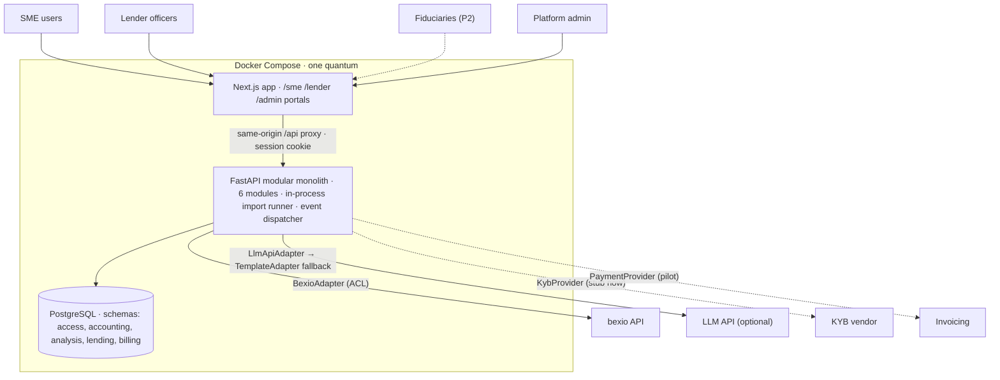
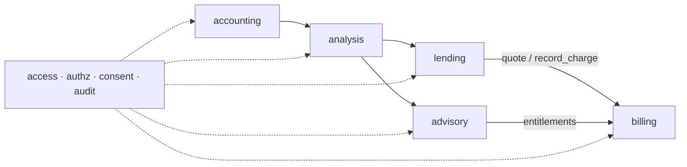

# CredSort Architecture

**Status:** Proposed for team approval · **Date:** 2026-11-19
**Supersedes, where different:** Architecture Plan v1 §2.1 (top characteristics), §3 (five modules), §10 (ADR register), and Master Plan v1 §2.2 ("SME access: free").

## At a glance

| | |
|---|---|
| **Style** | Domain-partitioned **modular monolith** with ports & adapters at the external edges; one architecture quantum ([ADR-0001](../adr/0001-modular-monolith.md)) |
| **Driving characteristics** | **Confidentiality · Data integrity · Evolvability**; feasibility (2 developers) as a hard constraint ([ADR-0012](../adr/0012-driving-architecture-characteristics.md)) |
| **Modules** | `access` · `accounting` · `analysis` · `lending` · `advisory` · **`billing`** (new) ([ADR-0002](../adr/0002-six-domain-modules.md)) |
| **Stack** | Next.js/TypeScript (one app, portals as route groups) → FastAPI/Python → PostgreSQL (schema per module); Docker Compose |
| **Business model** | **SMEs are charged** (amount and trigger TBD); pricing is versioned configuration, not code ([ADR-0013](../adr/0013-billing-and-sme-charging.md)) |
| **Money** | CredSort never holds or moves loan money; it invoices only its own fees ([ADR-0014](../adr/0014-no-loan-money-flow.md)) |
| **Trust rules** | Consent per field, no indirect disclosure, neutral and explainable ranking, AI explains but never calculates |

## Documents

| # | Document | Answers |
|---|---|---|
| 01 | [Architecture review](01-architecture-review.md) | What holds up in the v1 plans, what was missing, what changed |
| 02 | [Use case, users, screens, business model](02-use-case-and-screens.md) | How CredSort works for SMEs, lenders, fiduciaries and admins; screen inventory |
| 03 | [Domain model](03-domain-model.md) | Subdomains, six modules, ubiquitous language, context map, aggregates, events |
| 04 | [Architecture characteristics](04-architecture-characteristics.md) | The "-ilities", top 3, fitness functions, trade-offs between characteristics |
| 05 | [Architecture style & trade-offs](05-architecture-style.md) | Quanta, scored comparison of 7 styles, chosen style, accepted trade-offs, evolution path, repo layout |
| — | [ADRs](../adr/README.md) | 24 decisions with alternatives, consequences, compliance checks and revisit triggers |

## System overview

*(Second diagram: data flows left to right; downstream modules call upstream `api.py`. Upstream modules learn about downstream facts only via domain events.)*

## Open items for the team

| # | Item | Needed by |
|---|---|---|
| 1 | **SME fee: amount and trigger** (subscription tiers, per application, success-based, or a combination) | Before the publish/offer screens show real prices (T-M4/T-M5) |
| 2 | Does the **lender success fee** (0.75 %, min CHF 2,000, cap CHF 7,500) stay alongside the SME fee? | Same |
| 3 | Approve the ADRs (Proposed → Accepted) and assign owners | T-M0 |
| 4 | Legal review: fee model, AML implications of any servicing idea, data protection (nFADP), offer-data use for the benchmark | Before the pilot |
| 5 | Choose the KYB vendor, invoicing provider and pilot hosting (Swiss/EU) | Pilot preparation |
| 6 | Label milestones **T-M#** (technical, Architecture Plan) vs **P-M#** (product, Master Plan) | Now |
