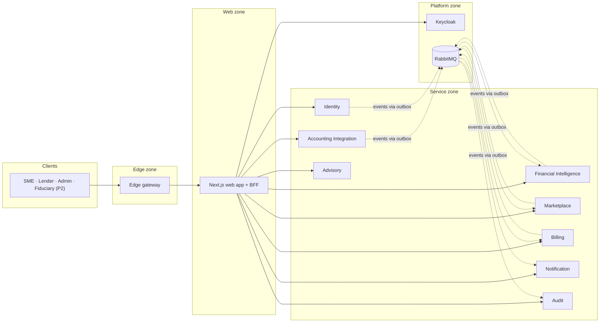

# CredSort Architecture

**Status:** Proposed for team approval · **Date:** 2026-11-19 · **Revision:** 2
**Supersedes, where different:** Architecture Plan v1 (style, modules, ADR register), Master Plan v1 §2.2 ("SME access: free"), and Revision 1 of this folder (modular monolith, commit `f45046c`).

## At a glance

| | |
|---|---|
| **Style** | **Service-based backbone** (six domain services, a database per service) + **event-driven integration** (transactional outbox, RabbitMQ) + **microkernel plug-ins** at every external edge + a **pipeline** for financial data ([ADR-0001](../adr/0001-architecture-style.md)) |
| **Driving characteristics** | **Confidentiality · Data integrity · Evolvability**; implementation effort is not a constraint ([ADR-0012](../adr/0012-driving-architecture-characteristics.md)) |
| **Domain services** | Identity · Accounting Integration · Financial Intelligence · Marketplace · Billing · Advisory ([ADR-0002](../adr/0002-service-decomposition.md)) |
| **Platform** | Web app + BFF (Next.js) · Edge gateway · Keycloak (OIDC + MFA) · RabbitMQ · Notification service · Audit service · OpenTelemetry |
| **Transactional core** | Applications, consent, matching, offers, selection and their audit live **inside Marketplace**, so "exactly one selected offer, consented and audited" is one ACID transaction ([ADR-0011](../adr/0011-consistency-model.md)) |
| **Business model** | **SMEs are charged** (amount and trigger TBD). Pricing is versioned configuration; fees are quoted (signed) before every action and charged exactly as quoted ([ADR-0013](../adr/0013-billing-and-sme-charging.md)) |
| **Money** | CredSort never holds or moves loan money ([ADR-0014](../adr/0014-no-loan-money-flow.md)) |

## Documents

| # | Document | Answers |
|---|---|---|
| 01 | [Architecture review](01-architecture-review.md) | What holds up in the v1 plans, what was missing, how the decision evolved |
| 02 | [Use case, users, screens, business model](02-use-case-and-screens.md) | How CredSort works for SMEs, lenders, fiduciaries and admins; screen inventory mapped to services |
| 03 | [Domain and service model](03-domain-model.md) | Subdomains, services, ubiquitous language, context map, aggregates, data ownership |
| 04 | [Architecture characteristics](04-architecture-characteristics.md) | The "-ilities", their priority, and the fitness functions that verify them |
| 05 | [Architecture style & trade-offs](05-architecture-style.md) | Case for and against every style and hybrid, scoring, quanta, chosen style |
| 06 | [Runtime & integration view](06-runtime-and-integration.md) | Sync vs async calls, event catalogue, the key flows step by step, consistency model |
| 07 | [Failure modes & risks](07-failure-modes-and-risks.md) | **Where this architecture can break**, how we detect it, and the design response |
| 08 | [Security & data protection](08-security-and-data-protection.md) | Trust zones, data classification per service, authentication and authorization flow |
| 09 | [Deployment & operations](09-deployment-and-operations.md) | Local/offline/live topology, pilot topology, CI/CD, backups and runbooks |
| — | [ADRs](../adr/README.md) | 31 decisions with alternatives, consequences, compliance checks and revisit triggers |

## System overview

Each service owns exactly one database, reachable only by that service. External systems connect only through plug-in adapters: bexio and synthetic data (Accounting), LLM/SLM/templates (Advisory), KYB vendor (Identity), invoicing (Billing, pilot).

## Where it can break (summary of [07](07-failure-modes-and-risks.md))

| Area | Main break points | Design response |
|---|---|---|
| Integrity | Lagging or duplicated events; quote vs charge mismatch; restoring one DB from backup | Outbox + idempotent inbox; signed quotes charged as quoted; reconciliation jobs; replay from outboxes |
| Confidentiality | Token theft or revocation lag; internal APIs reachable from the edge; sensitive data in events or logs | BFF keeps tokens server-side; 2-minute context tokens + deny-list; internal APIs not routable; thin events; log scrubbing |
| Availability | **Identity is a shared critical dependency**; Billing outage blocks fee-bearing actions without a valid quote (fail closed); Intelligence outage blocks publication | HA identity, token lifetimes; quotes prefetched and cached; explicit fail-closed messaging |
| Evolvability | Drift into a "distributed monolith"; breaking contract changes | Two-hop limit for sync calls; contract tests; schema versioning rules |

## Open items for the team

| # | Item | Needed by |
|---|---|---|
| 1 | **SME fee: amount and trigger** | Before fee-bearing screens show real prices |
| 2 | Keep the **lender success fee** (0.75 %, min CHF 2,000, cap CHF 7,500)? | Same |
| 3 | Approve the ADRs (Proposed → Accepted) and assign owners | Before coding starts |
| 4 | Legal review: fee model, AML implications of any servicing idea, nFADP, offer-data use for the benchmark, LLM provider terms | Before the pilot |
| 5 | Choose the KYB vendor, invoicing provider and pilot hosting region (Switzerland/EU) | Pilot preparation |
| 6 | Label milestones **T-M#** (technical) vs **P-M#** (product) in tickets | Now |
